# lbm3d — LBM 3D para escoamentos laminares (D3Q27, cumulante K17)

Solver de lattice-Boltzmann tridimensional em Python/NumPy, com operador de colisão de
cumulantes parametrizado (K17, difusão de 4ª ordem), paredes curvas, painel HTML de
convergência, checkpoint/reinício e casos de validação da literatura.

## Estrutura do repositório

```
lbm3d.py                    solver (método, casos de teste, transferência de calor, checkpoint, VTK,
                            contador de tempo, linha de comando)
lbm_kernel.c                núcleo em C (colisão + propagação e passo térmico), compilado sozinho
                            em build/ na primeira execução; sem compilador, o lbm3d.py usa NumPy
figuras.py                  imagens do domínio, condições de contorno, malha, escoamento e gráficos
acompanhar.py               acompanhamento da convergência (painel HTML, janela, terminal),
                            controle de uma simulação em andamento (salvar / pausar / parar) e
                            contador de todas as simulações em curso (--todos)
painel_template.html        modelo do painel HTML (autocontido, sem internet)
tests/test_lbm3d.py         testes rápidos do escoamento (pytest)
tests/test_calor.py         núcleo em C = NumPy, transferência de calor, contador, robustez (pytest)
resultados/                 casos simulados, um por pasta (índice em resultados/README.md)
referencias.bib             referências bibliográficas em BibTeX (seção Referências)
CLAUDE.md                   instruções para o Claude (documentar simulações, estimar tempo, git)
RODADAS_PENDENTES.md        comandos prontos das rodadas longas do cilindro (rodar no seu computador)
requirements.txt            numpy, matplotlib
requirements-dev.txt        + pytest
```

## Organização dos casos

Cada simulação grava tudo numa pasta própria, **`casos/<caso>_<parâmetros>/`** (ex.:
`casos/cylinder_D10_Re20`, `casos/spheres_L32_chi0.5`, `casos/duct_24x16`; `--outdir` escolhe outra):

```
casos/cylinder_D10_Re20/
  LEIAME.txt            o que há em cada subpasta e como continuar/controlar a simulação
  parametros.json       parâmetros da execução (malha, nu, omega, taxas de colisão, argumentos)
  execucao.log          cópia da saída do terminal (tabela de resíduos)
  estado.json           iteração, resíduos e situação (convergiu / interrompida / divergiu)
  validacao.txt         comparação com a referência da literatura
  dominio/              dominio_3d.png (vista 3D), dominio_cortes.png (fluido/sólido em 3 cortes)
  contorno/             contorno_cortes.png, contorno_3d.png (mapa colorido por tipo de condição),
                        condicoes_contorno.txt (descrição + contagem de nós/links),
                        perfil_entrada.png (cilindro: perfil de velocidade imposto)
  malha/                malha_corte.png (nós e linhas da malha), malha_detalhe.png (links
                        fluido→parede e a fração q do bounce-back interpolado), malha.txt
  escoamento/           final/ e parcial_itNNNNNNN/: velocidade_cortes.png (|u| em 3 cortes),
                        componentes_pressao.png (u_x, u_y, u_z, p), linhas_corrente.png, <caso>_itN.vtk
  graficos/             convergencia.png (resíduos), grandezas.png (C_D, C_L, C, erro L2 ...),
                        validação do caso, convergencia.csv e o painel convergencia.html
  checkpoint/           checkpoint.npz (estado completo para continuar)
```

As imagens do domínio, contorno e malha são geradas no início (≈2 s); para conferir a montagem de um
caso sem rodá-lo: `python lbm3d.py --case cylinder --res 10 --preprocess-only`. `--no-figs` desliga
todas as imagens (o VTK continua sendo gravado). A pasta `casos/`, os `.vtk` e os checkpoints não vão
para o repositório (`.gitignore`).

## Rodar no seu computador

Requisitos: Python ≥ 3.10, `numpy`, `matplotlib`.

```bash
pip install -r requirements.txt
python lbm3d.py --case duct                 # validação rápida (solução analítica)
python lbm3d.py --case cylinder --res 10    # benchmark Schäfer–Turek 3D-1Z
python lbm3d.py --restart casos/cylinder_D10_Re20   # continua de onde parou
```

Testes:

```bash
pip install -r requirements-dev.txt
pytest
```

## Contador de tempo de simulação

Toda simulação mostra um contador do tempo de simulação (classe `Contador` do `lbm3d.py`; não há
opção para desligá-lo):

* **terminal interativo:** linha viva atualizada a cada segundo, apagada antes de cada linha da
  tabela de resíduos:
  `[contador] 0h12m03s | it 12345 | 41.2 it/s | 37% | restante ~0h20m`
  (porcentagem e tempo restante quando o caso sabe estimar o progresso);
* **sem terminal** (segundo plano, `nohup`, log): uma linha `[contador]` por minuto no `execucao.log`
  e, ao final, o tempo total de simulação;
* **`andamento.json`** na pasta do caso (e em `graficos/`), regravado a cada segundo: situação,
  iteração, tempo decorrido (acumulado entre reinícios com `--restart`), velocidade, progresso e
  tempo restante;
* **painel HTML** (`graficos/convergencia.html`): o contador fica no cabeçalho e avança a cada segundo;
* **janela gráfica:** o contador fica no título;
* **todas as simulações em curso** (lê os `andamento.json`, atualiza a cada segundo):

```bash
python acompanhar.py --todos                     # casos em casos/
python acompanhar.py --todos --raiz outra/pasta  # outras pastas (pode repetir)
python acompanhar.py --todos --uma-vez --incluir-terminadas
```

## Transferência de calor (`--case calor`)

Convecção forçada 2D sobre cilindros circulares e não circulares, como em Cunha & Noleto (2026)
[CN26]: o escoamento é o mesmo solver de cumulantes D3Q27 (numa camada de nós, nz = 1) e a energia
é um segundo reticulado D3Q7 acoplado pela velocidade (formulação no item 10 da seção
**Formulação matemática e numérica**).

```bash
# Nu "sem sólido" (parede isotérmica) e "com sólido" (sólido conjugado, sistema concentrado)
python lbm3d.py --case calor --forma circulo --Re 100 --res 20
python lbm3d.py --case calor --forma circulo --Re 100 --res 20 --metodo com_solido
# seções não circulares da Fig. 9 de [CN26]
python lbm3d.py --case calor --forma quadrado45 --Re 200 --res 20
```

| Opção | Significado |
|---|---|
| `--forma` | `circulo`, `elipse` (2,5:1), `placa` (vertical, espessura D/10), `hexagono`, `hexagono45`, `quadrado`, `quadrado45`; D é sempre a altura da seção (transversal ao escoamento) |
| `--Re`, `--Pr` | Re = U D/ν; Pr = 0,7296 (ar a 25 °C) por padrão |
| `--res`, `--u-lattice` | D em nós e velocidade de entrada em unidades de rede (padrão U = 0,05) |
| `--Ds` | tamanho do domínio Ds/D (padrão da Tabela 1 de [CN26]: 80, 80, 40, 30 para Re = 1, 10, 100, 200) |
| `--metodo` | `sem_solido` (parede a 15 °C) ou `com_solido` (sólido conjugado inicialmente a 15 °C) |
| `--ks-kf`, `--Cs-Cf` | `com_solido`: razões de condutividade e de capacidade térmica volumétrica sólido/fluido |
| `--duracao` | casos transientes: duração em D/U (padrão 153 para Re = 100 e 131 para Re = 200, como em [CN26]) |

Domínio (Fig. 2 de [CN26]): entrada semicircular de diâmetro Ds, com u = U e T = 35 °C, mais as
laterais retas, que também são entrada; a saída é reta, a Ds/2 do centro, com ρ = 1 e ∂T/∂x = 0.

**Critérios de parada (os do artigo):**
* `sem_solido` estacionário (Re < 50): Eq. 16 adaptada ao LBM. O Nu é a média de 0,8 i_f a i_f
  (Eq. 11), como no artigo.
  * O artigo para quando |Nu − Nu₀|/Nu < 10⁻⁸ entre passos consecutivos. Esse critério é natural
    para o solver incompressível implícito do artigo.
  * No LBM, que é fracamente compressível, o Nu_inst carrega uma flutuação acústica residual
    (~10⁻⁵) que não decai, e a variação passo a passo da média fica num patamar ~3·10⁻⁸.
  * Aqui, a simulação para quando a média varia menos de 10⁻⁵ em 10 D/U, mantido por 5 D/U
    seguidos, ou seja, Nu convergido em 5 algarismos. Em Re = 10 (D = 5), isso ocorre em 129 D/U,
    perto dos ~140 D/U do artigo, e o Nu fica igual em 5 algarismos ao de 198 D/U.
* `sem_solido` transiente (Re ≥ 50): roda a duração em D/U e faz a média em 9 ciclos completos
  (período pela FFT, como na Fig. 5 de [CN26]).
* `com_solido`: para quando 1 − θ ≥ 0,98, com θ medido no centro do sólido. h vem do ajuste por
  mínimos quadrados da Eq. 14 em [round(0,99 i_f), i_f].

**Saída:** `resultado_calor.json` (Nu, Nu_ref, diferença, Biot, nº de instantes, Strouhal pelo período de C_L, C_L rms),
`graficos/nusselt.csv` (Nu_inst, θ do centro, C_D, C_L a cada passo) e os gráficos no formato do
artigo:
* `graficos/nusselt_historia.png`, `nusselt_7periodos.png` e `nusselt_fft.png` (Figs. 5 e 10);
* `graficos/solido_perfil_nusselt.png` e `solido_ajuste_h.png` (Figs. 6 e 7);
* `escoamento/final/temperatura.png` (Figs. 4, 8 e 11).

O VTK inclui o campo `theta`.

## Casos simulados

Resultados versionados em [`resultados/`](resultados) (índice e lista de arquivos em
[`resultados/README.md`](resultados/README.md)), todos com o modelo K17 e parâmetros do benchmark
(nenhum é ilustrativo; no caso de calor, as diferenças de parâmetros em relação ao artigo
estão indicadas na própria entrada).

### Duto retangular 24 × 16 — `duct_24x16`
Duto periódico com seção 24 × 16 nós, ν = 0,02, forçado por gradiente de pressão (u_max = 0,05), até
res(u) < 10⁻⁷ (12 600 it., ≈ 40 s no contêiner). **Erro L2 relativo do perfil = 1,694·10⁻³** (erro máximo
1,17·10⁻³ de u_max) contra a solução em série de White (2006). Rodado com a versão atual do código:
todas as subpastas estão preenchidas. Os valores de comparação citados antes neste README (BGK: 1,4·10⁻²;
cumulante clássico: 7,8·10⁻³) não têm arquivos em `resultados/` e não foram reverificados.

```bash
python lbm3d.py --case duct
```

[Pasta](resultados/duct_24x16) · 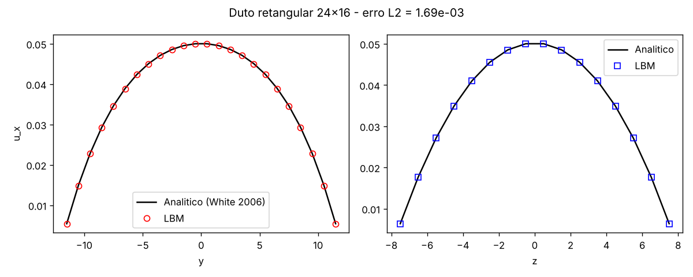

### Cilindro Schäfer–Turek 3D-1Z, D = 10 — `cylinder_D10_Re20`
Canal 2,5 × 0,41 × 0,41 m (malha 251 × 43 × 43, 464 099 nós, dx = 0,01 m), Re = 20, Um = 0,1 (rede).
**C_D = 6,230 e Δp = 0,1654 Pa dentro das faixas de referência; C_L = 0,0102, 1,7 % acima da faixa**
[0,008; 0,010]. Rodado antes da reorganização das pastas (por isso só há o log, a validação e o gráfico
da janela de acompanhamento); `dominio/`, `contorno/` e `malha/` foram regerados com a versão atual, mas
os campos do escoamento não foram guardados e a rodada não foi repetida com esta versão.

```bash
python lbm3d.py --case cylinder --res 10
```

[Pasta](resultados/cylinder_D10_Re20) · 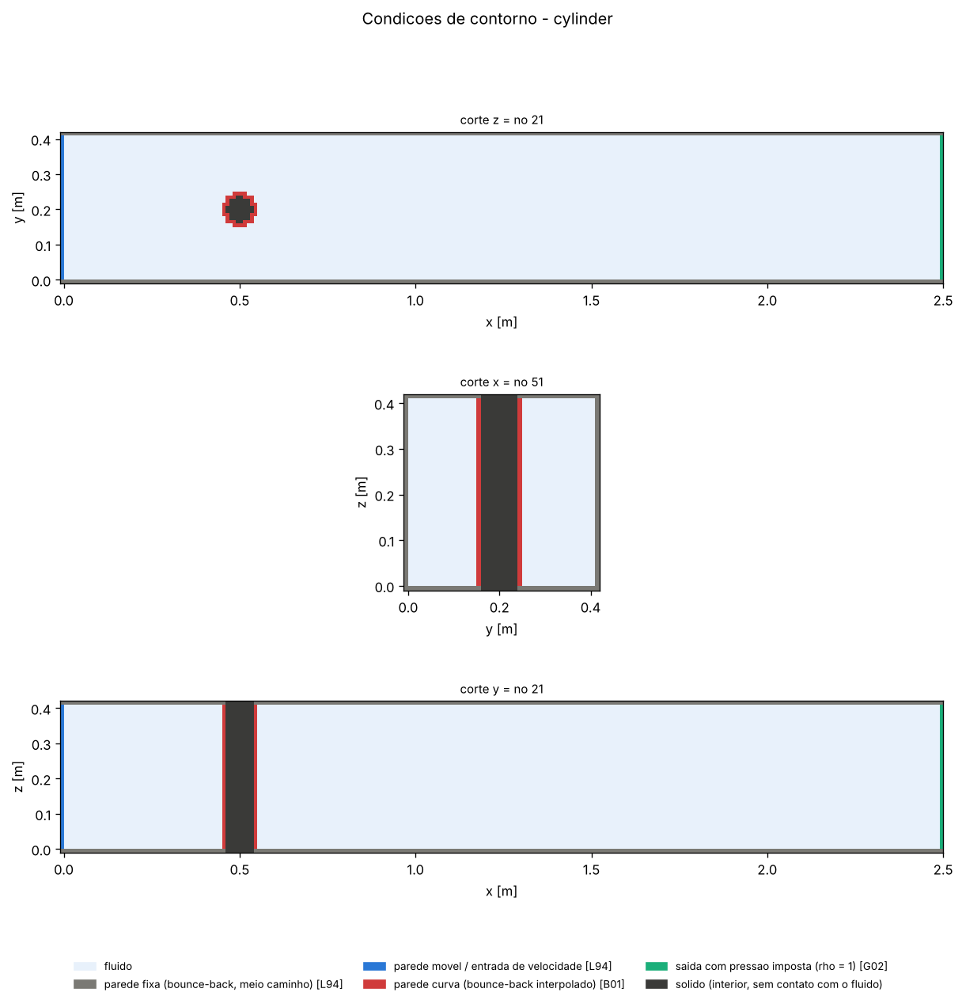

### Cilindro 3D-1Z — convergência de malha com Um = 0,05 (em andamento)
Série D = 6, 10, 16, 20 com a mesma velocidade de rede Um = 0,05 (Mach de rede ≈ 0,087), o K17 em todas
as malhas e parada em resíduo < 10⁻⁶. Objetivo: verificar se C_D e C_L entram nas faixas com o refino e
estimar a ordem de convergência (extrapolação de Richardson em `scripts/convergencia_malha.py`).
**Feito até agora: D = 6** (malha 151 × 27 × 27, 110 079 nós; 15 600 it., 25 min no contêiner):
C_D = 6,329 (acima da faixa [6,05; 6,25]), C_L = 0,0235 (2,3 × o limite superior), Δp = 0,1656 Pa (dentro
da faixa). Com D = 6 a malha é grosseira demais para o C_L; D = 10, 16 e 20 ainda não foram rodados
(estimativas: ~3 h, ~18 h e ~45 h no contêiner, a 1,2 MLUPS), e a rodada D = 10 antiga, com Um = 0,1,
não entra na série por ter outro número de Mach.

```bash
python lbm3d.py --case cylinder --res 6 --u-lattice 0.05 --tol 1e-6
bash scripts/estudo_malha_cilindro.sh          # D = 10, 16, 20 (retoma do checkpoint)
python scripts/convergencia_malha.py           # tabela, gráfico e Richardson
```

[Pasta D = 6](resultados/cylinder_D6_Re20_U0.05) · [Análise](resultados/cylinder_convergencia_malha) ·
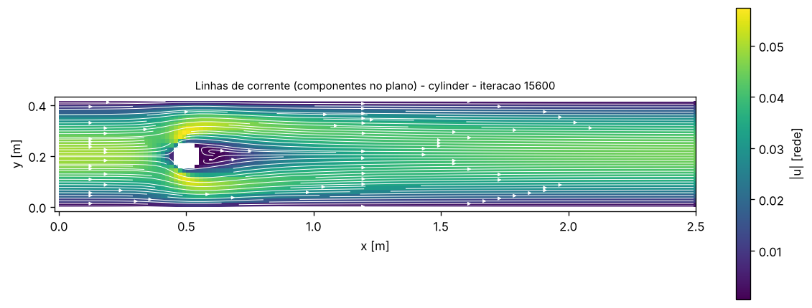

### Cilindro 3D-1Z — comparação de modelos de colisão (D = 6, Um = 0,05)
Mesma malha e parâmetros do D = 6 do estudo de malha, com os três modelos do código, todos até resíduo
< 10⁻⁶ (15 600–16 200 it., ~25 min cada no contêiner). **O K17 é o mais próximo da referência nas três
grandezas: C_D = 6,329 (+1,3 % acima da faixa) contra 6,764 (+8,2 %) no cumulante clássico e 6,883
(+10,1 %) no BGK; Δp = 0,1656 Pa dentro da faixa só no K17 (cumulante +3,5 %, BGK +6,3 % acima).** O
C_L fica fora da faixa nos três (0,0235 / 0,0337 / 0,0294), com o K17 de novo o melhor. Vale para esta
malha grosseira; não foi verificado se a vantagem se mantém em malhas finas.

```bash
python lbm3d.py --case cylinder --res 6 --u-lattice 0.05 --tol 1e-6 --model cumulant   # idem --model bgk
python scripts/comparar_cilindro.py --nome comparacao_modelos --saida resultados/cylinder_comparacao_modelos \
    "K17=resultados/cylinder_D6_Re20_U0.05" "cumulante=resultados/cylinder_D6_Re20_U0.05_cumulant" \
    "BGK=resultados/cylinder_D6_Re20_U0.05_bgk"
```

[Comparação](resultados/cylinder_comparacao_modelos) · [cumulante](resultados/cylinder_D6_Re20_U0.05_cumulant) ·
[BGK](resultados/cylinder_D6_Re20_U0.05_bgk) ·
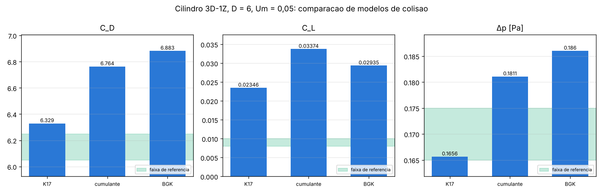

### Cilindro 3D-1Z — efeito da velocidade de rede / Mach (D = 6, K17)
Mesma malha D = 6, Re = 20, com Um = 0,1 / 0,05 / 0,025 (Ma = Um·√3 = 0,17 / 0,087 / 0,043), até resíduo
< 10⁻⁶ (9 900 / 15 600 / 22 300 it.). **A variação com Um é pequena perto do erro de malha: C_D = 6,302 /
6,329 / 6,343 (0,65 % de diferença entre os extremos), Δp = 0,1642 / 0,1656 / 0,1666 Pa (1,5 %) e
C_L = 0,0214 / 0,0235 / 0,0246 (15 %), enquanto o C_L está 2,1–2,5 × acima da faixa em todas.** Diminuir
Um afasta C_D e C_L da referência e leva Δp para dentro da faixa; a diferença cai pela metade a cada
redução de Um à metade (≈ 1ª ordem em Um). Com Re e D fixos, reduzir Um também reduz ν e muda as taxas
do K17, então a variação não é só efeito de compressibilidade, e não foi separada. Em D = 10 a
comparação Um = 0,1 × 0,05 sai do estudo de malha, ainda não rodado.

```bash
python lbm3d.py --case cylinder --res 6 --u-lattice 0.1 --tol 1e-6     # idem 0.05 e 0.025
python scripts/comparar_cilindro.py --nome efeito_mach --saida resultados/cylinder_efeito_mach \
    "Um=0,1=resultados/cylinder_D6_Re20" "Um=0,05=resultados/cylinder_D6_Re20_U0.05" \
    "Um=0,025=resultados/cylinder_D6_Re20_U0.025"
```

[Comparação](resultados/cylinder_efeito_mach) · [Um = 0,1](resultados/cylinder_D6_Re20) ·
[Um = 0,025](resultados/cylinder_D6_Re20_U0.025) ·
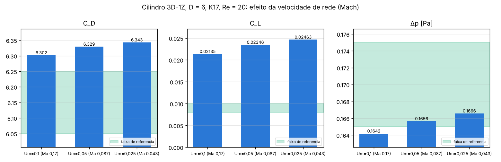

### Cilindro 3D-1Z — limitador de 3ª ordem do K17 (D = 6, Um = 0,05)
O mesmo D = 6 com o limitador de [G17] (`--limiter 0.01`), que aproxima de 1 as taxas dos cumulantes de
3ª ordem onde eles são grandes. Convergiu nas mesmas 15 600 it. (25 min). **O limitador piora levemente
o resultado: C_D = 6,367 contra 6,329 sem limitador (+0,6 %, mais longe da faixa), C_L = 0,0241 contra
0,0235; Δp = 0,1667 contra 0,1656 Pa (ambos dentro da faixa).** Como o caso já é estável sem ele, não há
motivo para usá-lo aqui. Só foi testado o valor 0,01 e só nesta malha.

```bash
python lbm3d.py --case cylinder --res 6 --u-lattice 0.05 --tol 1e-6 --limiter 0.01
```

[Comparação](resultados/cylinder_efeito_limitador) · [Pasta](resultados/cylinder_D6_Re20_U0.05_lim0.01) ·
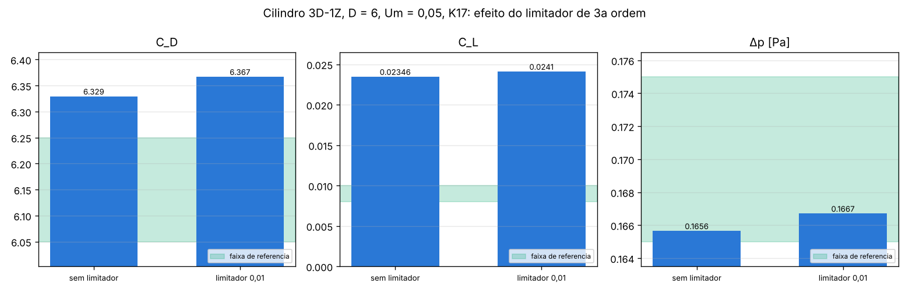

### Cilindro 3D-1Z — grandezas extraídas dos campos (D = 6)
Pós-processamento (`scripts/pos_cilindro.py`) do campo final das seis rodadas com D = 6, no plano
z = H/2: comprimento da bolha de recirculação L_a, ângulo de separação, C_p junto à parede (referência:
traseira) e perfis de u_x a jusante. **Com o K17, L_a ≈ 0,66 D e separação a ≈ 151° da frente, quase
iguais com Um = 0,1 / 0,05 / 0,025 e com o limitador; o cumulante clássico e o BGK dão bolhas ≈ 7–9 %
menores (0,60 e 0,62 D).** Com só 3 nós no raio esses valores são grosseiros, e não conferi se o caso
3D-1Z tem referência para eles: servem para comparar rodadas entre si, e a convergência de malha
(D = 10, 16, 20) dirá quanto mudam com o refino. Não é uma simulação nova.

```bash
python scripts/pos_cilindro.py casos/cylinder_D6_Re20_U0.05     # precisa do .vtk (não versionado)
```

[Tabela](resultados/cylinder_pos_processamento/pos_processamento.txt) ·
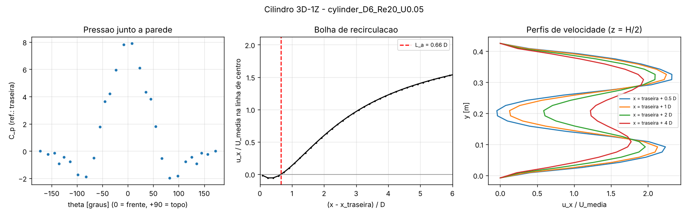

### Cilindro 3D-2Z (Re = 100, não estacionário), D = 6 — `cylinder2z_D6_Re100`
Primeira rodada do caso novo `cylinder2z` (mesma geometria do 3D-1Z, Um = 2,25 m/s, Ū = 1 m/s,
Re = 100), D = 6, Um = 0,1 (rede), K17 (ω = 1,969), 150 tempos convectivos = 15 s físicos (20 300 it.,
~32 min no contêiner). **Com D = 6 não houve desprendimento de vórtices: depois do transiente inicial
(~2 s) o escoamento fica estacionário, com C_D = 3,66, C_L = −0,023 e Δp = 3,40 Pa, e oscilação residual
de C_L de só 3·10⁻⁴ pico a pico.** Não verifiquei a causa (malha grosseira com 3 nós no raio é a
hipótese mais provável) nem comparei com o artigo, cujas faixas para o 3D-2Z não estão no código.
O `execucao.log` mostra um "St = 1,8873" da primeira versão da análise, que tratava essa oscilação
residual como desprendimento; a análise foi corrigida (exige C_L pico a pico > 10⁻², limiar escolhido
por mim, e oscilação que não amorteça) e o `validacao.txt` foi refeito a partir da série gravada.

```bash
python lbm3d.py --case cylinder2z --res 6
```

[Pasta](resultados/cylinder2z_D6_Re100) ·
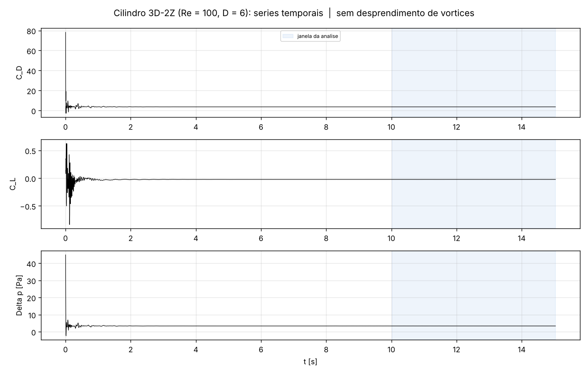

### Arranjo cúbico de esferas, L = 32 — `spheres_L32_chi0.3`, `0.5`, `0.7`
Célula periódica 32³ com uma esfera de diâmetro χL, ν = 0,02, regime de Stokes (Re_p ≤ 0,11).
**C = 1,713 / 2,858 / 6,062 para χ = 0,3 / 0,5 / 0,7 (erro +0,77 / +0,47 / +1,04 %)** em relação a
Sangani & Acrivos (1982), valores tabelados em Bogner et al. (2015). Rodados antes da reorganização:
há log, CSV e painel de convergência; os campos do escoamento não foram guardados.

```bash
python lbm3d.py --case spheres --res 32 --chi 0.5     # idem --chi 0.3 e 0.7
```

[χ = 0,3](resultados/spheres_L32_chi0.3) · [χ = 0,5](resultados/spheres_L32_chi0.5) · [χ = 0,7](resultados/spheres_L32_chi0.7) ·
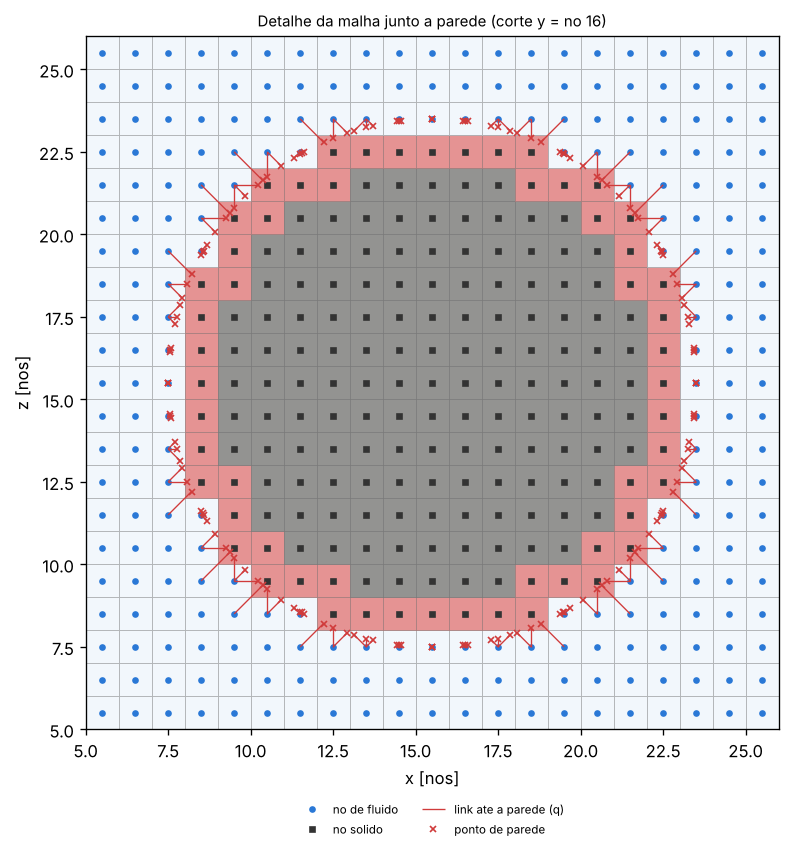

### Arranjo cúbico de esferas, L = 48, χ = 0,5 — `spheres_L48_chi0.5`
Mesmo caso com malha 48³. **C = 2,852 (erro +0,23 %)**; com L = 32 o erro era +0,47 %. A "ordem observada
≈ 1,8" citada anteriormente vem de só duas resoluções e não foi recalculada aqui. Rodado antes da
reorganização (sem campos do escoamento).

```bash
python lbm3d.py --case spheres --res 48 --chi 0.5
```

[Pasta](resultados/spheres_L48_chi0.5) · 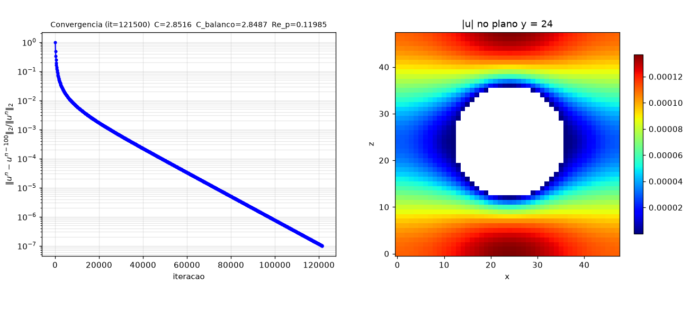

### Convecção forçada sobre cilindros, campanha de [CN26] — `calor_CN26`
Os 48 casos do artigo Cunha & Noleto (2026), em 2D (nz = 1), com Pr = 0,7296 e os domínios da
Tabela 1. Foram rodados:
* círculo com os dois métodos (sem sólido e com sólido conjugado), Re = 1, 10, 100 e 200, em três
  malhas cada: D = 5/7/10 nós para Re ≤ 10 e D = 10/14/20 para Re ≥ 100;
* as seis seções não circulares da Fig. 9, sem sólido, na malha fina, nos mesmos quatro Re.

U = 0,02 (Re = 1) ou 0,05 em unidades de rede. A campanha levou ~38 h de relógio, com 3 processos
simultâneos.

**Método sem sólido, malha fina:** Nu = 0,820 / 1,868 / 5,125 / 7,153 para Re = 1 / 10 / 100 / 200.
O artigo dá 0,798 / 1,837 / 5,109 / 7,394. Contra a correlação de referência (Eq. 17), a diferença
é de 3,7 / 0,8 / 1,6 / 1,3 %; no artigo, 0,9 / 0,9 / 1,9 / 2,1 %.

**Método com sólido, malha fina:** Nu = 0,778 / 1,756 / 4,931 / 7,211, contra 0,793 / 1,863 /
5,082 / 7,414 no artigo. A diferença para a Eq. 17 é de 1,7 / 5,2 / 5,4 / 0,5 %.

**Seções não circulares:** os Nu diferem em média 5,8 % dos da Tabela 6 (21 de 24 acima), com a mesma ordem
entre as seções. A diferença vai de 0,2 % (elipse) a 15 % (quadrado em Re = 200). Nas correlações
Nu = C Re^m Pr^(1/3), o expoente m fica a ≤ 0,013 do ajuste feito aos dados do artigo.

**Strouhal (pela sustentação C_L):** 0,166 e 0,197 para o círculo em Re = 100 e 200.

**O que não foi verificado ou difere do artigo:**
* No método com sólido, o Nu depende mais da malha em Re ≥ 100. Na malha grossa (D = 10), a
  camada limite térmica tem menos de um nó; o artigo mostra o mesmo comportamento na Tabela 3.
* Em Re = 1 e 10, as propriedades do sólido não são as do cobre: (ρc_p)s/(ρc_p)f = 277 e 104, com
  ks/kf = 157, para que o caso termine em tempo viável. Isso não altera o Nu, mas o Biot fica
  ~2,5·10⁻³, contra ~2,5·10⁻⁵ no artigo. Continua ≪ 0,1, o que mantém válida a hipótese de
  sistema concentrado.
* O critério estacionário é a Eq. 16 adaptada ao LBM (média com 5 algarismos estáveis).
* Na elipse em Re = 100 quase não há desprendimento (C_L rms = 0,007), então o St desse caso não é
  significativo.
* O artigo não traz Strouhal para comparar.

```bash
python campanha_calor.py --plano completo --rodar --processos 3 --menores-primeiro
python campanha_calor.py --relatorio        # tabelas 2–6 e Fig. 12 em resultados/calor_CN26/
```

[Pasta](resultados/calor_CN26) ·
[Comparação completa (formato das Tabelas 2–6 e da Fig. 12)](resultados/calor_CN26/comparacao_CN26.md) ·
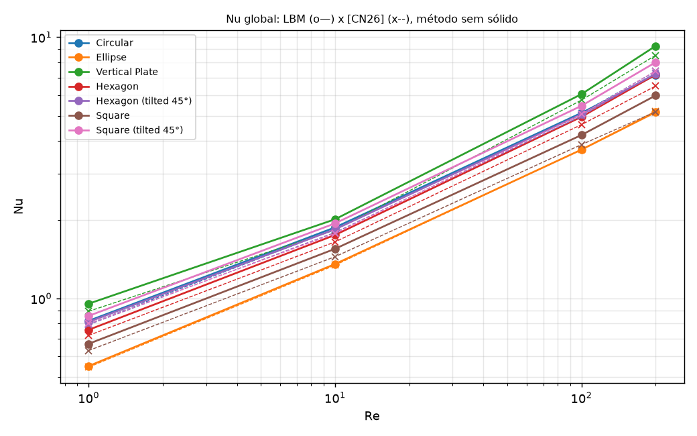
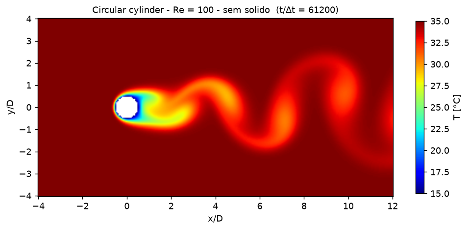

## Resíduos

A cada `--report-every` iterações (padrão 100) o terminal imprime uma linha da tabela:

```
 iteracao     res(u)    res(ux)    res(uy)    res(uz)   res(rho)   MLUPS      tempo  grandezas monitoradas
     3000  4.289e-03  4.289e-03  6.284e-07  4.545e-07  5.488e-09    0.67   0h00m08s  L2_error=0.0365582
```

* `res(u) = ‖uⁿ − uⁿ⁻¹⁰⁰‖₂ / ‖uⁿ‖₂` sobre os nós de fluido — critério de parada (`res(u) < --tol`, padrão 1e-7);
* `res(ux)`, `res(uy)`, `res(uz)`: a mesma variação por componente, normalizada por `‖uⁿ‖₂`
  (logo `res(u)² = res(ux)² + res(uy)² + res(uz)²`);
* `res(rho) = ‖ρⁿ − ρⁿ⁻¹⁰⁰‖₂ / ‖ρⁿ‖₂`;
* MLUPS, tempo decorrido e as grandezas do caso.

A mesma linha vai para `graficos/convergencia.csv` (colunas `res`, `res_ux`, `res_uy`, `res_uz`,
`res_rho`) e para `execucao.log`; `graficos/convergencia.png` mostra as curvas.
(Linha acima: duto 24×16, de `resultados/duct_24x16/execucao.log`.)

## Salvar resultados parciais e interromper

| Ação | Janela gráfica | Terminal (`--no-gui`) | Qualquer modo (outro terminal, segundo plano, remoto) |
|---|---|---|---|
| Salvar resultado parcial agora | botão **Salvar** / tecla `S` | `Ctrl+C` → `s` | `python acompanhar.py <pasta> --salvar` (ou crie `<pasta>/SALVAR`); `kill -USR1 <pid>` |
| Pausar / continuar | botão **Pausar** / tecla `P` | `Ctrl+C` → `p` (de novo `Ctrl+C` → `c`) | `--pausar` / `--continuar` (arquivo `<pasta>/PAUSAR`) |
| Salvar e parar | botão **Salvar e sair** / `Q` / fechar janela | `Ctrl+C` → `q` (ou `Ctrl+C` duas vezes) | `--parar` (arquivo `<pasta>/PARAR`); `SIGTERM` |
| Salvar parciais periodicamente | caixa **Auto-salvar parciais** | `--save-every N` (padrão 1000; 0 desliga) | idem |
| Continuar depois | `python lbm3d.py --restart <pasta do caso>` | idem | idem |

* **Resultado parcial** = `escoamento/parcial_itNNNNNNN/` (imagens + `.vtk`), gráficos atualizados em
  `graficos/` e `checkpoint/checkpoint.npz`.
* O checkpoint também é regravado a cada `--checkpoint-every` iterações (padrão 100), para limitar o
  que se perde se o processo for morto sem aviso.
* Os arquivos de controle são verificados a cada 10 iterações; `SALVAR` e `PARAR` são apagados ao serem
  atendidos, e sobras de uma execução anterior são apagadas no início.
* Sem terminal interativo (ex.: com saída redirecionada para arquivo), `Ctrl+C`/`SIGTERM` salvam e encerram
  direto, sem menu.
* Ao parar, a última situação vai para `escoamento/parcial_itN/` (ou `final/`, se terminou) e `estado.json`.

O reinício reproduz bit a bit uma execução contínua. No reinício você pode alterar `--max-iter`,
`--tol`, `--save-every`, `--checkpoint-every`, `--no-gui`, `--no-figs`, `--outdir`, `--max-time`,
`--report-every`; os parâmetros físicos vêm do checkpoint. `--max-time M` encerra após M minutos
salvando o checkpoint (útil para dividir rodadas longas em trechos).

### Painel HTML de convergência
A cada 100 iterações o código acrescenta uma linha a `graficos/convergencia.csv` e regrava
**`graficos/convergencia.html`**, uma página autocontida (sem internet, sem bibliotecas externas).
Basta abri-la no navegador: ela se recarrega sozinha a cada 5 s. Para atualização ao vivo sem
recarregar (e para acompanhar de outro computador via túnel SSH), sirva a pasta:

```bash
python acompanhar.py casos/spheres_L32_chi0.5 --servir        # http://127.0.0.1:8765/convergencia.html
python acompanhar.py casos/spheres_L32_chi0.5                 # (re)gera o HTML e abre no navegador
```

O painel mostra:
* estado da simulação (rodando / convergida / parada ou pausada / divergiu) e há quanto tempo veio a última leitura;
* iteração, resíduo, taxa de convergência (décadas por 1000 it.), velocidade (it/s e MLUPS) e
  **estimativa do tempo restante** até a tolerância (extrapolação log-linear das últimas 20 leituras);
* curva do resíduo em escala log com a tolerância e a extrapolação;
* evolução de cada grandeza do caso (C_D, C_L, Δp, C, erro L2 …) com a **faixa de referência da
  literatura** sombreada, a variação relativa nas últimas 500 it., e opção "Tudo"/"Último terço";
* valores ao passar o mouse e uma tabela com as últimas 30 leituras (incluindo os resíduos por
  componente); tema claro/escuro automático.

Outros modos: `--janela` (matplotlib), `--texto` (terminal, ex.: via ssh), `--png` (imagem estática).

## Formulação matemática e numérica

Esta seção descreve o modelo que o `lbm3d.py` resolve e como ele é discretizado, na ordem em que o
código executa um passo de tempo. As equações usam unidades de rede (Δx = Δt = 1, ρ₀ = 1); a
conversão para unidades físicas está no item 9. Entre colchetes estão as referências da lista ao fim
do README e, quando útil, a função do código que implementa cada parte.

### 1. Problema físico

O objetivo é resolver escoamentos laminares, incompressíveis e isotérmicos de um fluido newtoniano,
com uma força de corpo **F** opcional (gradiente de pressão imposto ou aceleração):

$$
\nabla\cdot\mathbf u = 0,\qquad
\frac{\partial \mathbf u}{\partial t} + (\mathbf u\cdot\nabla)\mathbf u
= -\frac{1}{\rho_0}\nabla p + \nu\,\nabla^2\mathbf u + \frac{\mathbf F}{\rho_0}.
$$

O método de lattice-Boltzmann não resolve essas equações diretamente. Ele evolui funções de
distribuição de partículas $f_i(\mathbf x,t)$ e, pela expansão de Chapman–Enskog, recupera as
equações de Navier–Stokes **fracamente compressíveis**, com equação de estado isotérmica

$$
p = c_s^2\,\rho,\qquad c_s^2 = \tfrac13 .
$$

O erro de compressibilidade em relação ao problema incompressível é de ordem $\mathrm{Ma}^2$, com
$\mathrm{Ma} = U/c_s = \sqrt3\,U$. Por isso as velocidades de rede são mantidas pequenas
(U ≤ 0,1, ou seja, Ma ≲ 0,17).

### 2. Rede D3Q27 e equação de lattice-Boltzmann

**Velocidades discretas.** São as 27 combinações $\mathbf c_i = (a-1,\,b-1,\,c-1)$, com
$a,b,c \in \{0,1,2\}$. No código as populações ficam no vetor `f[a, b, c, x, y, z]`; o índice
linear é $d = 9a+3b+c$, e a direção oposta é $\bar d = 26-d$ (`CV`, `OPP`).

**Pesos.** São o produto de pesos 1D, $w_{abc} = w_a w_b w_c$, com $(w_0,w_1,w_2) = (1/6,\,2/3,\,1/6)$
(`W`):

| Grupo | Nº de direções | Peso |
|---|---|---|
| repouso, $\mathbf c = 0$ | 1 | 8/27 |
| faces, $\lvert\mathbf c\rvert = 1$ | 6 | 2/27 |
| arestas, $\lvert\mathbf c\rvert = \sqrt2$ | 12 | 1/54 |
| vértices, $\lvert\mathbf c\rvert = \sqrt3$ | 8 | 1/216 |

**Equação de evolução.** Cada passo é dividido em colisão (local) e propagação:

$$
f_i^{*}(\mathbf x,t) = f_i(\mathbf x,t) + \Omega_i\big(f(\mathbf x,t)\big),\qquad
f_i(\mathbf x+\mathbf c_i,\,t+1) = f_i^{*}(\mathbf x,t).
$$

**Grandezas macroscópicas** (`macroscopic`). A velocidade inclui metade da força de corpo, o que
torna o esquema de forçamento de 2ª ordem (item 5):

$$
\rho = \sum_i f_i,\qquad
\rho\,\mathbf u = \sum_i f_i\,\mathbf c_i + \tfrac12\,\mathbf F .
$$

**Viscosidade.** A viscosidade cinemática é dada pela taxa de relaxação de cisalhamento $\omega_1$:

$$
\nu = c_s^2\left(\frac1{\omega_1}-\frac12\right) = \frac13\left(\frac1{\omega_1}-\frac12\right)
\quad\Longleftrightarrow\quad
\omega_1 = \frac{1}{3\nu+\tfrac12}.
$$

Cada caso escolhe ν (diretamente, ou a partir de Re e da velocidade de referência), e o código
calcula $\omega_1$ com essa relação. É preciso $0<\omega_1<2$, ou seja, ν > 0.

### 3. Momentos centrais e cumulantes

A colisão não é feita sobre as populações, e sim sobre os **cumulantes**, que são invariantes
galileanos e estatisticamente independentes entre si [G15]. O caminho é
populações → momentos centrais → cumulantes → relaxação → momentos centrais → populações.

**Momentos centrais.** São os momentos na velocidade local do fluido, normalizados por ρ:

$$
\kappa_{\alpha\beta\gamma} = \frac1\rho\sum_i f_i\,(c_{ix}-u_x)^\alpha\,(c_{iy}-u_y)^\beta\,(c_{iz}-u_z)^\gamma .
$$

**Transformação "chimera"** [G15, Apêndice J] (`_fwd`, `_bwd`). Como a rede é um produto de três
redes 1D de 3 velocidades, a transformação é aplicada uma direção por vez: z, depois y, depois x.
Em cada linha de três valores $(f_-, f_0, f_+)$, com $u$ a componente da velocidade naquela direção:

$$
\kappa_0 = f_- + f_0 + f_+,\qquad
\kappa_1 = (f_+-f_-) - u\,\kappa_0,\qquad
\kappa_2 = (f_++f_-) - 2u\,(f_+-f_-) + u^2\kappa_0 .
$$

A inversa, aplicada na ordem x, y, z, é

$$
f_- = \tfrac12\big[(u^2-u)\,\kappa_0 + (2u-1)\,\kappa_1 + \kappa_2\big],\quad
f_0 = (1-u^2)\,\kappa_0 - 2u\,\kappa_1 - \kappa_2,\quad
f_+ = \tfrac12\big[(u^2+u)\,\kappa_0 + (2u+1)\,\kappa_1 + \kappa_2\big].
$$

Isso custa O(27) operações por nó, em vez das O(27²) de uma matriz de momentos geral.

**Cumulantes.** São os coeficientes da expansão do logaritmo da transformada de Laplace da
distribuição. Em termos dos momentos centrais (já normalizados por ρ):

* 2ª e 3ª ordens: são iguais aos momentos centrais, por exemplo $c_{200}=\kappa_{200}$,
  $c_{110}=\kappa_{110}$, $c_{210}=\kappa_{210}$, $c_{111}=\kappa_{111}$;
* 4ª ordem:

$$
c_{211} = \kappa_{211} - (\kappa_{200}\kappa_{011} + 2\kappa_{110}\kappa_{101}),\qquad
c_{220} = \kappa_{220} - (\kappa_{200}\kappa_{020} + 2\kappa_{110}^2)
$$

  e permutações;
* 5ª ordem:

$$
c_{221} = \kappa_{221} - (\kappa_{200}\kappa_{021} + \kappa_{020}\kappa_{201}
+ 4\kappa_{110}\kappa_{111} + 2\kappa_{101}\kappa_{120} + 2\kappa_{011}\kappa_{210})
$$

  e permutações;
* 6ª ordem:

$$
\begin{aligned}
c_{222} = \kappa_{222}
&- \big[\kappa_{200}\kappa_{022} + \kappa_{020}\kappa_{202} + \kappa_{002}\kappa_{220}
      + 4(\kappa_{110}\kappa_{112} + \kappa_{101}\kappa_{121} + \kappa_{011}\kappa_{211})\big] \\
&- \big[2(\kappa_{210}\kappa_{012} + \kappa_{201}\kappa_{021} + \kappa_{120}\kappa_{102})
      + 4\kappa_{111}^2\big] \\
&+ 2\big[\kappa_{200}\kappa_{020}\kappa_{002}
      + 2(\kappa_{200}\kappa_{011}^2 + \kappa_{020}\kappa_{101}^2 + \kappa_{002}\kappa_{110}^2)
      + 8\kappa_{110}\kappa_{101}\kappa_{011}\big].
\end{aligned}
$$

Os cumulantes de 4ª a 6ª ordem relaxam com taxa 1 (item 4). Por isso o código não precisa
calculá-los antes da colisão: usa essas fórmulas só no sentido inverso, para reconstruir os momentos
centrais pós-colisão a partir dos cumulantes de equilíbrio (`_cumulant_relax`).

**Equilíbrio** (`equilibrium`). É a Maxwelliana discreta, cujos momentos centrais se fatoram por
direção: $\kappa^{eq}_{\alpha\beta\gamma} = e_\alpha e_\beta e_\gamma$, com $e = (1,\,0,\,1/3)$
(`KEQ`). Por exemplo, $\kappa^{eq}_{200} = 1/3$, $\kappa^{eq}_{220} = 1/9$, $\kappa^{eq}_{222} = 1/27$,
e os momentos com algum índice ímpar são nulos. Em cumulantes, o único não nulo além de $c_{000}$ é
$c^{eq}_{200} = c^{eq}_{020} = c^{eq}_{002} = c_s^2 = 1/3$. As populações de equilíbrio
$f^{eq}(\rho,\mathbf u)$ são obtidas aplicando a transformação inversa a $\rho\,\kappa^{eq}$.

### 4. Operador de colisão

Cada grupo de cumulantes relaxa para o equilíbrio com sua própria taxa,
$c^{*} = c + \omega\,(c^{eq} - c)$, ou seja, $c^{*} = (1-\omega)\,c + \omega\,c^{eq}$
(`collide`, `_cumulant_relax`). Há três modelos (`--model`).

#### 4.1 Cumulante clássico [G15] (`--model cumulant`)

**Gradientes de velocidade.** São estimados localmente a partir dos cumulantes de 2ª ordem
pré-colisão (válidos até a ordem dominante da expansão) [G15, Eqs. 58–60], com
$T = c_{200}+c_{020}+c_{002}$:

$$
\begin{aligned}
\partial_x u_x &= -\tfrac{\omega_1}{2}\,(2c_{200}-c_{020}-c_{002}) - \tfrac{\omega_2}{2}\,(T-1),\\
\partial_y u_y &= \partial_x u_x + \tfrac{3\omega_1}{2}\,(c_{200}-c_{020}),\qquad
\partial_z u_z = \partial_x u_x + \tfrac{3\omega_1}{2}\,(c_{200}-c_{002}),\\
\partial_x u_y + \partial_y u_x &= -3\,\omega_1\,c_{110}\quad(\text{idem } xz,\ yz).
\end{aligned}
$$

**2ª ordem.** As partes desviadoras e os termos fora da diagonal relaxam com $\omega_1$
(viscosidade de cisalhamento). O traço relaxa com $\omega_2$ (viscosidade volumétrica), e no código
$\omega_2 = 1$. Os termos em $u^2\,\partial u$ são a correção galileana [G15, Eqs. 61–63], que remove
o erro cúbico na velocidade da rede D3Q27:

$$
\begin{aligned}
(c_{200}-c_{020})^{*} &= (1-\omega_1)\,(c_{200}-c_{020})
  - 3\left(1-\tfrac{\omega_1}{2}\right)\big(u_x^2\,\partial_x u_x - u_y^2\,\partial_y u_y\big),\\
(c_{200}-c_{002})^{*} &= (1-\omega_1)\,(c_{200}-c_{002})
  - 3\left(1-\tfrac{\omega_1}{2}\right)\big(u_x^2\,\partial_x u_x - u_z^2\,\partial_z u_z\big),\\
T^{*} &= T + \omega_2\,(1-T)
  - 3\left(1-\tfrac{\omega_2}{2}\right)\big(u_x^2\,\partial_x u_x + u_y^2\,\partial_y u_y + u_z^2\,\partial_z u_z\big),\\
c_{110}^{*} &= (1-\omega_1)\,c_{110}\quad(\text{idem } c_{101},\ c_{011}).
\end{aligned}
$$

Os valores diagonais são recompostos como
$c_{200}^{*} = \tfrac13\big[T^{*} + (c_{200}-c_{020})^{*} + (c_{200}-c_{002})^{*}\big]$, e
analogamente para $c_{020}^{*}$ e $c_{002}^{*}$.

**3ª ordem.** Relaxa em combinações simétricas e antissimétricas:

$$
(c_{210}+c_{012})^{*} = (1-\omega_3)\,(c_{210}+c_{012}),\qquad
(c_{210}-c_{012})^{*} = (1-\omega_4)\,(c_{210}-c_{012}),\qquad
c_{111}^{*} = (1-\omega_5)\,c_{111}
$$

e o mesmo para os pares $(c_{201},c_{021})$ e $(c_{120},c_{102})$. No cumulante clássico,
$\omega_3=\omega_4=\omega_5=1$.

**4ª a 6ª ordens.** Taxa 1: todos vão para o equilíbrio, que é zero.

**Limitador opcional** (`--limiter λ`) [G17, Eq. 20]. Quando $\omega\neq1$, a taxa de cada
combinação de 3ª ordem passa a ser $\omega' = \omega + (1-\omega)\,\dfrac{|c|}{\lambda+|c|}$. Isso
leva cumulantes grandes (escoamento mal resolvido) para o equilíbrio, sem alterar os pequenos.

#### 4.2 Cumulante parametrizado K17 [G17] (`--model k17`, padrão)

A estrutura é a mesma do 4.1, mas as taxas de 3ª ordem e os equilíbrios de 4ª ordem são escolhidos
para que a difusão tenha **precisão de 4ª ordem**. Com $\omega_2 = 1$ e $\omega \equiv \omega_1$
(`k17_parameters`):

$$
\begin{aligned}
\omega_3 &= \frac{8(\omega-2)(1+2\omega)}{7\omega^2-14\omega-8}, \qquad
\omega_4 = \frac{8(\omega-2)(4\omega-7)}{9\omega^2-50\omega+56}, \qquad
\omega_5 = \frac{24(\omega-2)(3\omega^2-7\omega-2)}{29\omega^3-130\omega^2+152\omega+48},\\[4pt]
A &= \frac{4+2\omega-3\omega^2}{2-7\omega+5\omega^2}, \qquad
B = \frac{4+28\omega-14\omega^2}{6-21\omega+15\omega^2}.
\end{aligned}
$$

Os cumulantes de 4ª ordem relaxam (com taxa 1) para equilíbrios proporcionais aos gradientes de
velocidade:

$$
\begin{aligned}
c_{022}^{*} &= -\left(\tfrac1{\omega}-\tfrac12\right)\tfrac23\,A\,(\partial_y u_y + \partial_z u_z)
  \quad(\text{idem } c_{202},\ c_{220}),\\
c_{112}^{*} &= -\left(\tfrac1{\omega}-\tfrac12\right)\tfrac13\,B\,(\partial_x u_y + \partial_y u_x)
  \quad(\text{idem } c_{121},\ c_{211}),
\end{aligned}
$$

e os de 5ª e 6ª ordens continuam indo para zero. Essas expressões foram conferidas com o
código-fonte aberto do VirtualFluids (TU Braunschweig), de onde vêm o K17 e o artigo [G17].

**Faixa de validade.** Com $\omega_2 = 1$, $A$ tem um polo em $\omega = 1$, e $\omega_4$ tem um polo
em $\omega \approx 1{,}556$ (fica fora de (0, 2) para 1,43 < ω < 1,75). Nos testes de onda de
cisalhamento, o K17 só foi estável e mais preciso que o clássico para **ω ≥ 1,75 (ν ≤ 0,024)**, o
regime de baixa viscosidade para o qual ele foi criado. Abaixo disso, `collision_parameters` troca
automaticamente para o cumulante clássico e imprime um aviso.

#### 4.3 BGK (`--model bgk`)

Todos os momentos centrais relaxam com a mesma taxa $\omega_1$ para $\kappa^{eq}$. Como a
transformação para momentos centrais é linear para **u** fixo, isso equivale ao BGK clássico
$\Omega_i = \omega_1\,(f_i^{eq} - f_i)$ com o equilíbrio fatorado do item 3. Serve como referência
de comparação.

### 5. Força de corpo

A força entra em dois lugares [G15]:

1. Na velocidade, $\rho\mathbf u = \sum f_i\mathbf c_i + \mathbf F/2$. Com isso, o momento central
   de 1ª ordem pré-colisão vale $\kappa_{100} = -F_x/(2\rho)$.
2. Na colisão, esse momento troca de sinal: $\kappa_{100}^{*} = +F_x/(2\rho)$ (idem y, z).

A quantidade de movimento de cada nó aumenta, portanto, exatamente **F** por passo, e a velocidade
física é a média entre os instantes pré- e pós-colisão. Esse é o forçamento de 2ª ordem usual do LBM
(análogo ao esquema de Guo, Zheng e Shi [GZS02]). Ele é usado para impor o gradiente de pressão no duto
($F_x = G = -\mathrm dp/\mathrm dx$) e a aceleração no arranjo de esferas ($F_x = \rho g$).

### 6. Discretização espacial e geometria

A malha é cartesiana e uniforme, com Δx = 1. Os sólidos são representados por uma máscara booleana
nos nós (`case.solid`).

* **Posição das paredes.** O nó $(i,j,k)$ fica na coordenada $(i-\tfrac12,\,j-\tfrac12,\,k-\tfrac12)$.
  Assim, uma camada de nós sólidos "fantasma" em $j=0$ coloca a parede plana exatamente a meio
  caminho entre o nó sólido e o primeiro nó de fluido, onde o bounce-back simples é de 2ª ordem.
* **Paredes curvas** (cilindro, esferas). Um nó é sólido se o seu centro está dentro do corpo. Para
  cada **link** fluido → sólido (nó de fluido $\mathbf x_f$, direção $\mathbf c_d$ com
  $\mathbf x_f+\mathbf c_d$ sólido), a fração $q\in(0,1]$ do link até a superfície vem da interseção
  exata do segmento com a esfera ou o cilindro, ou seja, a menor raiz de
  $|\mathbf p + q\,\mathbf c_d|^2 = R^2$ (com $\mathbf p = \mathbf x_f - \mathbf x_c$; no cilindro
  só as componentes x e y). A lista de links é montada uma única vez (`build_links`).
* **Periodicidade.** A propagação usa `np.roll`, que é periódica em todas as direções. Onde há
  parede, a condição de contorno sobrescreve as populações que atravessariam o sólido.

### 7. Condições de contorno

Todas as condições de parede usam a mesma fórmula por link (`Links.apply`), aplicada logo após a
propagação. Ela define a população que volta para o fluido, $f_{\bar d}(\mathbf x_f,t+1)$:

$$
f_{\bar d}(\mathbf x_f,t+1) = A_1\,f_d^{*}(\mathbf x_f) + A_2\,f_d^{*}(\mathbf x_f-\mathbf c_d)
+ A_3\,f_{\bar d}^{*}(\mathbf x_f) + m_w .
$$

| Condição | Coeficientes |
|---|---|
| Parede fixa, bounce-back a meio caminho [L94] | $A_1=1$, $A_2=A_3=0$ |
| Parede curva, $q<\tfrac12$ [B01] | $A_1=2q$, $A_2=1-2q$ |
| Parede curva, $q\ge\tfrac12$ [B01] | $A_1=\tfrac1{2q}$, $A_3=\tfrac{2q-1}{2q}$ |
| Parede móvel com velocidade $\mathbf u_w$ [L94] | $m_w = -2\,w_d\,\rho_w\,(\mathbf c_d\cdot\mathbf u_w)/c_s^2 = -6\,w_d\,(\mathbf c_d\cdot\mathbf u_w)$, com $\rho_w = 1$ |

Na parede curva com $q<\tfrac12$, se o nó $\mathbf x_f-\mathbf c_d$ não for fluido, o código recai
no bounce-back simples.

**Entrada com velocidade imposta** (cilindro). A entrada é uma parede móvel em $x=0$, com o perfil
de Schäfer–Turek avaliado no ponto médio de cada link:

$$
u_w(y,z) = \frac{16\,U_m\,y\,z\,(H-y)(H-z)}{H^4}.
$$

A tampa da cavidade usa a mesma condição, com $\mathbf u_w = (U,0,0)$.

**Saída com pressão imposta** (cilindro), pela extrapolação de não-equilíbrio [G02]
(`Cylinder.post_stream`). No último plano $x_b$, as populações são substituídas usando o penúltimo
plano $x_{b-1}$:

$$
f_i(\mathbf x_b) = f_i^{eq}\big(1,\,\mathbf u(\mathbf x_{b-1})\big)
+ \Big[f_i(\mathbf x_{b-1}) - f_i^{eq}\big(\rho(\mathbf x_{b-1}),\,\mathbf u(\mathbf x_{b-1})\big)\Big].
$$

Ou seja, ρ = 1 (p = 1/3) é imposto, a velocidade é extrapolada com ordem zero e a parte de
não-equilíbrio é copiada do vizinho.

**Nós sólidos.** A cada passo eles são reinicializados com $f_i = w_i$ (equilíbrio em repouso), para
que nenhum valor espúrio se acumule dentro do corpo.

**Força sobre o corpo** (troca de quantidade de movimento [M02], `Links.force`). A força é a soma,
sobre os links do corpo, da quantidade de movimento que sai e volta em cada link:

$$
\mathbf F = \sum_{\text{links}} \mathbf c_d\,\Big[f_d^{*}(\mathbf x_f,t) + f_{\bar d}(\mathbf x_f,t+1)\Big].
$$

No arranjo de esferas, soma-se a ela o empuxo $\rho g V_p$ para obter a força total por esfera.

### 8. Algoritmo de um passo de tempo (`Simulation.step`)

1. **Colisão**, em blocos de planos x para que os temporários do NumPy caibam no cache: ρ e **u**
   (com F/2) → momentos centrais → relaxação dos cumulantes (item 4) → populações pós-colisão $f^{*}$.
   ρ e **u** ficam guardados para a saída.
2. **Nós sólidos** ← $w_i$.
3. **Propagação** periódica: $f_i(\mathbf x+\mathbf c_i) \leftarrow f_i^{*}(\mathbf x)$, num segundo
   vetor.
4. **Paredes** (bounce-back simples, interpolado e móvel) aplicadas aos links.
5. **Condições específicas do caso**, como a saída de pressão do cilindro.
6. **Força no corpo**, nos casos com obstáculo.
7. Troca dos dois vetores de populações e $t \leftarrow t+1$.

**Condição inicial.** É o equilíbrio $f_i = f_i^{eq}(\rho_0,\mathbf u_0)$, com ρ₀ = 1 e $\mathbf u_0$
dado pelo caso: repouso, perfil de entrada ou onda senoidal.

**Precisão.** O esquema é de 2ª ordem no espaço e no tempo, desde que o forçamento seja o do item 5
e as paredes estejam a meio caminho ou sejam interpoladas [B01]. O K17 eleva a difusão para 4ª ordem
na faixa de ω do item 4.2.

### 9. Unidades, parâmetros adimensionais e convergência

**Unidades de rede.** Cada caso fixa a resolução (D, N, L) e a velocidade de rede $U$, e calcula a
viscosidade de rede a partir do número de Reynolds, $\nu = U\,L_{ref}/\mathrm{Re}$. Para converter
para unidades físicas, usa-se a semelhança de Re: $\Delta x = L_{fis}/L_{rede}$, a escala de
velocidade $U_{fis}/U_{rede}$, e as diferenças de pressão

$$
\Delta p_{fis} = \rho_{fis}\,\Big(\tfrac{U_{fis}}{U_{rede}}\Big)^2\,c_s^2\,\Delta\rho_{rede}.
$$

No cilindro, por exemplo, $\Delta p_{fis} = \tfrac13\,\Delta\rho\,(0{,}2/\bar U_{rede})^2$ Pa, com
ρ_fis = 1 kg/m³ e Ū = 0,2 m/s.

**Escolhas que controlam o erro.**

* Ma = √3·U pequeno. O cilindro usa $U_m = 0{,}1$, logo Ma ≈ 0,17 no máximo e
  Ma(Ū) ≈ 0,08.
* Re de partícula ≪ 1 no arranjo de esferas: g é escolhido para $u_s \approx 10^{-4}$.
* $\omega_1$ longe de 2 (ν não muito pequeno), para estabilidade, e na faixa adequada ao modelo
  escolhido.

**Estado estacionário.** A simulação é avançada no tempo (pseudo-transiente) até o resíduo
$\mathrm{res}(u) = \lVert\mathbf u^n-\mathbf u^{n-100}\rVert_2/\lVert\mathbf u^n\rVert_2$, calculado
sobre os nós de fluido, ficar abaixo de `--tol` (seção **Resíduos**). Casos transientes, como a onda
de cisalhamento, rodam um número fixo de iterações.

**Verificações incluídas.** Os casos de teste conferem partes diferentes da formulação:

* a viscosidade numérica (onda de cisalhamento, $A(t) \propto e^{-\nu k^2 t}$);
* a invariância galileana (onda com advecção, `--u-adv`);
* o forçamento e as paredes planas (duto, contra a série de White);
* as paredes curvas e a força por troca de quantidade de movimento (cilindro e esferas).

### 10. Transferência de calor (`--case calor`)

**Equação.** A energia é resolvida em forma conservativa, com um único campo para fluido e sólido
[CN26]:

$$
\frac{\partial (C\,T)}{\partial t} + \nabla\cdot(C_f\,T\,\mathbf u) = \nabla\cdot(k\,\nabla T),
$$

* C = ρc_p é a capacidade térmica volumétrica e k a condutividade;
* no fluido, C = C_f e k = k_f, logo α = k_f/C_f = ν/Pr;
* no sólido, u = 0, C = C_s e k = k_s;
* em unidades de rede, C_f = 1 e k_f = α.

**Rede D3Q7 e equilíbrio** (`equilibrio_termico`). A energia E = C T é o momento de ordem zero.
Usa-se $c_s^2 = 1/4$, $w_0 = 1/4$ e $w_i = 1/8$, com a velocidade do escoamento no instante t:

$$
g_0^{eq} = E - T + w_0\,T,\qquad
g_i^{eq} = w_i\,T\left(1 + \frac{\mathbf c_i\cdot\mathbf u}{c_s^2}\right)\quad(i = 1\ldots6),\qquad
T = E/C.
$$

Como $\sum_i g_i^{eq} = E$, a expansão de Chapman–Enskog dá a equação acima. A capacidade térmica
só entra na conversão T = E/C, e o fluxo $-k\nabla T$ é contínuo na interface sólido–fluido sem
nenhuma condição de contorno ali.

Isso resolve de uma vez os dois problemas do método conjugado que [CN26] discute (Seção 3.2):

* **Desbalanço de fluxo** quando c_p,s ≠ c_p,f: não ocorre, porque o fluxo depende só de k e de ∇T.
* **Capacidade volumétrica do sólido:** é preservada, porque C entra diretamente, sem trocar ρ_s
  e c_p,s (equivale a $\rho_s^{*}c_{p,s}^{*} = \rho_s c_{p,s}$).

**Colisão TRT** [G05] (`thermal_collide_stream` em `lbm_kernel.c` e `passo_termico_numpy`).
Separam-se as partes simétrica e antissimétrica de cada par $(i,\bar\imath)$:

$$
g_i^{*} = g_i - \omega^{+}\big(g_i^{+} - g_i^{eq+}\big) - \omega^{-}\big(g_i^{-} - g_i^{eq-}\big),
\qquad
k = c_s^2\left(\frac{1}{\omega^{-}} - \frac12\right),
\qquad
\Big(\frac{1}{\omega^{+}}-\frac12\Big)\Big(\frac{1}{\omega^{-}}-\frac12\Big) = \Lambda = \frac14 .
$$

$\omega^{-}$ é ajustado nó a nó pela condutividade local. O parâmetro "mágico" Λ = 1/4 mantém o
esquema estável e preciso mesmo com $1/\omega^{-}$ grande, como num sólido muito condutor.

**Parede isotérmica com interpolação** [LMK13] (`build_links_termicos`, `LinksTermicos.apply`).
Esta é a versão com anti-bounce-back da regra de Bouzidi, com q a fração do link até a parede:

$$
\begin{aligned}
q<\tfrac12:&\quad g_{\bar\imath}(\mathbf x_f,t+1) = -2q\,g_i^{*}(\mathbf x_f) + (2q-1)\,g_i^{*}(\mathbf x_f-\mathbf c_i) + 2w_iT_w,\\
q\ge\tfrac12:&\quad g_{\bar\imath}(\mathbf x_f,t+1) = -\tfrac{1}{2q}\,g_i^{*}(\mathbf x_f) + \tfrac{2q-1}{2q}\,g_{\bar\imath}^{*}(\mathbf x_f) + \tfrac{1}{q}\,w_iT_w .
\end{aligned}
$$

**Calor trocado e Nusselt.** O calor que sai do fluido para a parede num passo é o balanço exato
de energia nos links da parede, e não exige reconstruir gradientes:

$$
Q = \sum_{\text{links}}\Big[g_i^{*}(\mathbf x_f) - g_{\bar\imath}(\mathbf x_f,t+1)\Big],
\qquad
\mathrm{Nu}_{inst} = \frac{Q\,D}{k_f\,P\,(T_\infty - T_w)}.
$$

P é o perímetro exato da seção, por unidade de profundidade. Na condução entre dois cilindros
concêntricos, Q difere da solução exata $2\pi\alpha\Delta T/\ln(r_2/r_1)$ em menos de 0,3%
(`tests/test_calor.py`).

**Nu com sólido** (Eq. 14 de [CN26]). Com Bi < 0,1, o sólido segue o modelo de sistema concentrado
$\theta = \exp(-b t)$, com $b = h P / (C_s A)$. h é o valor que minimiza
$\sum (T_{CFD} - T_{REF}(h))^2$ nos últimos 1% dos instantes, e $\mathrm{Nu} = h D / k_f$.

**Contorno térmico do domínio:**
* entrada e laterais: T = T∞, por anti-bounce-back no meio do caminho;
* saída: ∂T/∂x = 0, copiando as populações do plano anterior.

**Núcleo em C.** O passo térmico custa cerca de 15% do passo do escoamento. A colisão de
cumulantes e a propagação também rodam em C (`lbm_kernel.c`) e dão o mesmo resultado do NumPy até
o arredondamento (≤ 10⁻¹⁵, conferido em `tests/test_calor.py`).

## Casos (`--case`)

Os casos são classes em `lbm3d.py` (dicionário `CASES`). O modelo padrão é `--model k17`, mas o K17 só
vale para ω ≥ 1,75 (ν ≤ 0,024): fora disso o código usa automaticamente o cumulante clássico [G15] e
avisa. A coluna "modelo efetivo" indica o que roda com os parâmetros padrão.

| Caso | Descrição | Referência / grandeza | Parâmetros padrão | Modelo efetivo |
|---|---|---|---|---|
| `shearwave` | onda de cisalhamento periódica (decaimento viscoso) | decaimento exato `exp(−ν k² t)` [G17]; erro na viscosidade | N = 32, ν = 0,01 | K17 |
| `duct` | duto retangular periódico em x, forçado por gradiente de pressão | White (2006), Eq. 3-48; erro L2 do perfil | 24 × 16, ν = 0,02 | K17 |
| `cylinder` | cilindro em canal de seção quadrada, Re = 20 | Schäfer & Turek (1996), 3D-1Z; C_D ∈ [6,05; 6,25], C_L ∈ [0,008; 0,010], Δp ∈ [0,165; 0,175] Pa | D = 10, Um = 0,1 | K17 (para D ≥ 12 recai no cumulante clássico) |
| `spheres` | arranjo cúbico simples de esferas, regime de Stokes | Sangani & Acrivos (1982); arraste C = f_t/(3πμ d u_s) | L = 32, χ = 0,5, ν = 0,02 | K17 |
| `calor` | convecção forçada 2D sobre cilindros (7 seções), Nu com e sem sólido | [CN26]; Nu de referência pela Eq. 17 (Churchill–Bernstein [CB77]) para o círculo | círculo, Re = 100, D = 20, U = 0,05, Pr = 0,7296 | K17 se ω ≥ 1,75, senão cumulante clássico |
| `cylinder2z` | cilindro em canal, Re = 100, não estacionário (roda até `--max-iter`, padrão 150 D/Ū) | Schäfer & Turek (1996), 3D-2Z; C_D máx., C_L máx./mín., Δp, Strouhal (faixas do artigo ainda não incluídas) | D = 10, Um = 0,1 | K17 (ν = 0,0044) |
| `cavity` | cavidade cúbica com tampa móvel (demonstração) | comparar com Albensoeder & Kuhlmann (2005); perfis centrais | N = 32, Re = 100, U = 0,1 | cumulante clássico (ν = 0,032) |

Solução do duto (−a ≤ y ≤ a, −b ≤ z ≤ b, G = −dp/dx):

```
u(y,z) = 16a²G/(μπ³) Σ_{i=1,3,5,…} (−1)^((i−1)/2) [1 − cosh(iπz/2a)/cosh(iπb/2a)] cos(iπy/2a) / i³
```

Schäfer–Turek 3D-1Z: canal 2,5 × 0,41 × 0,41 m, cilindro com D = 0,1 m em (0,5; 0,2), ν = 10⁻³ m²/s,
entrada `U = 16·Um·y·z·(H−y)(H−z)/H⁴`, com Um = 0,45 m/s, Ū = 4Um/9 = 0,2 m/s,
`C_D = 2F_x/(ρŪ²DH)`, `C_L = 2F_y/(ρŪ²DH)`, `Δp = p(0,45; 0,2; 0,205) − p(0,55; 0,2; 0,205)`.

Arranjo de esferas: célula periódica L³ com uma esfera de diâmetro d = χL (fração sólida
φ = πχ³/6), forçada por aceleração g; u_s = velocidade superficial, f_t = força de arraste por
troca de quantidade de movimento + empuxo ρgV_p. Série de Sangani & Acrivos:
`1/C = 1 − 1,7601x + x³ − 1,5593x⁶ + 3,9799x⁸ − 3,0734x¹⁰ + …`, com x = φ^(1/3) (boa até χ ≈ 0,7);
valores de referência para χ = 0,2…0,9 retirados da Tab. 1 de Bogner et al. (2015).

## Referências

Todas as referências estão em **[`referencias.bib`](referencias.bib)** (BibTeX). O arquivo pode ser
usado direto em LaTeX (`\bibliography{referencias}`) ou importado no Zotero, Mendeley ou JabRef.
Autores, volumes, páginas e DOIs foram conferidos no Crossref (doi.org) em novembro de 2026. As
siglas entre colchetes são as usadas neste README e nos comentários do `lbm3d.py`; a chave BibTeX
de cada uma está na tabela abaixo.

### O que citar em cada parte de um artigo

| Parte do método ou do trabalho | Onde está no código | Referências | Chaves BibTeX |
|---|---|---|---|
| Este código | `lbm3d.py` | [lbm3d] | `Noleto2026lbm3d` |
| Método de lattice-Boltzmann (visão geral, Chapman–Enskog, rede D3Q27) | — | [KKK17] | `Kruger2017` |
| Operador de cumulantes, transformação chimera, correção galileana | `collide`, `_cumulant_relax`, `_fwd`, `_bwd` | [G15] | `Geier2015` |
| Parametrização K17 (ω₃, ω₄, ω₅, A, B) e limitador de 3ª ordem | `k17_parameters`, `_cumulant_relax` | [G17]; conferido com [VF] | `Geier2017a`, `VirtualFluids` |
| Força de corpo (forçamento de 2ª ordem com F/2) | `macroscopic`, `_cumulant_relax` | [G15]; análogo a [GZS02] | `Geier2015`, `Guo2002b` |
| Paredes planas e móveis (bounce-back a meio caminho) | `build_links`, `Links.apply` | [L94] | `Ladd1994` |
| Paredes curvas (bounce-back interpolado linear) | `build_links` | [B01] | `Bouzidi2001` |
| Saída com pressão imposta (extrapolação de não-equilíbrio) | `Cylinder.post_stream` | [G02] | `Guo2002a` |
| Força sobre o corpo (troca de quantidade de movimento) | `Links.force` | [M02] | `Mei2002` |
| Transferência de calor: método conjugado e casos de validação | `CilindroCalor` | [CN26] | `Cunha2026` |
| Colisão TRT do campo térmico (Λ = 1/4) | `thermal_collide_stream` | [G05] | `Ginzburg2005` |
| Parede isotérmica curva (anti-bounce-back interpolado) | `build_links_termicos` | [LMK13] | `Li2013` |
| Nu de referência do cilindro circular (Eq. 17 de [CN26]) | `nu_churchill_bernstein` | [CB77] | `Churchill1977` |
| Correlações de Nu para seções não circulares (Fig. 9 de [CN26]) | — | [SAT04] | `Sparrow2004` |
| Validação: duto retangular | `Duct` | [W06] | `White2006` |
| Validação: cilindro 3D-1Z (Re = 20) | `Cylinder` | [ST96] | `Schafer1996` |
| Validação: arranjo cúbico de esferas | `SphereArray` | [SA82], [H59]; valores de [BMR15] | `Sangani1982`, `Hasimoto1959`, `Bogner2015` |
| Cavidade com tampa móvel (comparação sugerida) | `Cavity` | [AK05], [K87] | `Albensoeder2005`, `Ku1987` |
| Software | — | [NumPy], [Matplotlib] | `Harris2020`, `Hunter2007` |
| Trabalhos posteriores com o K17 (revisão bibliográfica) | não implementado | [G17b] | `Geier2017b` |

### Texto-base para a seção de métodos

Os parágrafos abaixo resumem o método com as citações já no lugar, para servir de ponto de partida
na seção de métodos de um artigo. Revise os parâmetros (resolução, ν, Re, modelo efetivo) conforme
o caso simulado: por exemplo, se ω < 1,75 o código troca o K17 pelo cumulante clássico.

**Em português:**

> As simulações foram feitas com um código próprio de lattice-Boltzmann em Python/NumPy
> \cite{Noleto2026lbm3d, Harris2020}, na rede D3Q27 \cite{Kruger2017}. A colisão usa o operador de
> cumulantes \cite{Geier2015} com a parametrização K17, que dá precisão de quarta ordem à difusão
> \cite{Geier2017a}; a viscosidade volumétrica é relaxada com ω₂ = 1. A força de corpo entra com um
> esquema de segunda ordem, somando metade da força à velocidade macroscópica \cite{Geier2015, Guo2002b}.
> As paredes planas e móveis usam bounce-back a meio caminho \cite{Ladd1994}; as superfícies curvas,
> bounce-back interpolado linear \cite{Bouzidi2001}; e a saída tem pressão imposta por extrapolação
> de não-equilíbrio \cite{Guo2002a}. As forças sobre os corpos são calculadas por troca de
> quantidade de movimento \cite{Mei2002}. O código foi validado com a solução em série do duto
> retangular \cite{White2006}, com o caso 3D-1Z de Schäfer e Turek \cite{Schafer1996} e com o
> arraste no arranjo cúbico de esferas \cite{Sangani1982, Bogner2015}.

**Em inglês:**

> Simulations were carried out with an in-house lattice Boltzmann code written in Python/NumPy
> \cite{Noleto2026lbm3d, Harris2020} on the D3Q27 lattice \cite{Kruger2017}. Collisions are
> computed with the cumulant operator \cite{Geier2015} using the K17 parametrization for
> fourth-order accurate diffusion \cite{Geier2017a}, with the bulk relaxation rate set to ω₂ = 1.
> Body forces are included through a second-order scheme in which half of the force is added to
> the macroscopic velocity \cite{Geier2015, Guo2002b}. Planar and moving walls are modelled with
> half-way bounce-back \cite{Ladd1994}, curved surfaces with linearly interpolated bounce-back
> \cite{Bouzidi2001}, and the outlet pressure is imposed by non-equilibrium extrapolation
> \cite{Guo2002a}. Forces on immersed bodies are obtained by momentum exchange \cite{Mei2002}. The
> code was validated against the series solution for rectangular duct flow \cite{White2006}, the
> 3D-1Z benchmark of Schäfer and Turek \cite{Schafer1996}, and the drag on a simple cubic array of
> spheres \cite{Sangani1982, Bogner2015}.

### Lista completa

**Este código**
* [lbm3d] L. Noleto, *lbm3d: solver de lattice-Boltzmann D3Q27 com operador de colisão de
  cumulantes parametrizado (K17) para escoamentos laminares tridimensionais*, código-fonte em
  Python/NumPy, Universidade de Brasília, 2026. Antes de citar, ajuste no `referencias.bib` o
  título, a versão (commit) e onde o código pode ser obtido.

**Método numérico**
* [G15] M. Geier, M. Schönherr, A. Pasquali, M. Krafczyk, *The cumulant lattice Boltzmann
  equation in three dimensions: Theory and validation*, Comput. Math. Appl. 70 (4) (2015) 507–547.
  [doi:10.1016/j.camwa.2015.05.001](https://doi.org/10.1016/j.camwa.2015.05.001)
* [G17] M. Geier, A. Pasquali, M. Schönherr, *Parametrization of the cumulant lattice Boltzmann
  method for fourth order accurate diffusion. Part I: Derivation and validation*, J. Comput. Phys.
  348 (2017) 862–888. [doi:10.1016/j.jcp.2017.05.040](https://doi.org/10.1016/j.jcp.2017.05.040)
* [G17b] M. Geier, A. Pasquali, M. Schönherr, *Parametrization of the cumulant lattice Boltzmann
  method for fourth order accurate diffusion. Part II: Application to flow around a sphere at drag
  crisis*, J. Comput. Phys. 348 (2017) 889–898.
  [doi:10.1016/j.jcp.2017.07.004](https://doi.org/10.1016/j.jcp.2017.07.004)
* [VF] VirtualFluids, código de pesquisa em lattice-Boltzmann do iRMB, TU Braunschweig.
  <https://git.rz.tu-bs.de/irmb/VirtualFluids>
* [KKK17] T. Krüger, H. Kusumaatmaja, A. Kuzmin, O. Shardt, G. Silva, E.M. Viggen, *The Lattice
  Boltzmann Method: Principles and Practice*, Springer, Cham, 2017.
  [doi:10.1007/978-3-319-44649-3](https://doi.org/10.1007/978-3-319-44649-3)

**Condições de contorno e forçamento**
* [L94] A.J.C. Ladd, *Numerical simulations of particulate suspensions via a discretized Boltzmann
  equation. Part 1. Theoretical foundation*, J. Fluid Mech. 271 (1994) 285–309.
  [doi:10.1017/S0022112094001771](https://doi.org/10.1017/S0022112094001771)
* [B01] M. Bouzidi, M. Firdaouss, P. Lallemand, *Momentum transfer of a Boltzmann-lattice fluid with
  boundaries*, Phys. Fluids 13 (11) (2001) 3452–3459.
  [doi:10.1063/1.1399290](https://doi.org/10.1063/1.1399290)
* [G02] Z.-L. Guo, C.-G. Zheng, B.-C. Shi, *Non-equilibrium extrapolation method for velocity and
  pressure boundary conditions in the lattice Boltzmann method*, Chinese Phys. 11 (4) (2002)
  366–374. [doi:10.1088/1009-1963/11/4/310](https://doi.org/10.1088/1009-1963/11/4/310)
* [GZS02] Z. Guo, C. Zheng, B. Shi, *Discrete lattice effects on the forcing term in the lattice
  Boltzmann method*, Phys. Rev. E 65 (4) (2002) 046308.
  [doi:10.1103/PhysRevE.65.046308](https://doi.org/10.1103/PhysRevE.65.046308)
* [M02] R. Mei, D. Yu, W. Shyy, L.-S. Luo, *Force evaluation in the lattice Boltzmann method
  involving curved geometry*, Phys. Rev. E 65 (4) (2002) 041203.
  [doi:10.1103/PhysRevE.65.041203](https://doi.org/10.1103/PhysRevE.65.041203)

**Casos de validação**
* [W06] F.M. White, *Viscous Fluid Flow*, 3ª ed., McGraw-Hill, Nova York, 2006 (Eq. 3-48).
  ISBN 978-0-07-240231-5.
* [ST96] M. Schäfer, S. Turek, F. Durst, E. Krause, R. Rannacher, *Benchmark computations of
  laminar flow around a cylinder*, in: E.H. Hirschel (ed.), *Flow Simulation with High-Performance
  Computers II*, Notes Numer. Fluid Mech. 52, Vieweg+Teubner, 1996, pp. 547–566.
  [doi:10.1007/978-3-322-89849-4_39](https://doi.org/10.1007/978-3-322-89849-4_39)
* [SA82] A.S. Sangani, A. Acrivos, *Slow flow through a periodic array of spheres*, Int. J.
  Multiphase Flow 8 (4) (1982) 343–360.
  [doi:10.1016/0301-9322(82)90047-7](https://doi.org/10.1016/0301-9322%2882%2990047-7)
* [H59] H. Hasimoto, *On the periodic fundamental solutions of the Stokes equations and their
  application to viscous flow past a cubic array of spheres*, J. Fluid Mech. 5 (2) (1959) 317–328.
  [doi:10.1017/S0022112059000222](https://doi.org/10.1017/S0022112059000222)
* [BMR15] S. Bogner, S. Mohanty, U. Rüde, *Drag correlation for dilute and moderately dense
  fluid-particle systems using the lattice Boltzmann method*, Int. J. Multiphase Flow 68 (2015)
  71–79. [doi:10.1016/j.ijmultiphaseflow.2014.10.001](https://doi.org/10.1016/j.ijmultiphaseflow.2014.10.001)
  ([arXiv:1401.2025](https://arxiv.org/abs/1401.2025))
* [AK05] S. Albensoeder, H.C. Kuhlmann, *Accurate three-dimensional lid-driven cavity flow*,
  J. Comput. Phys. 206 (2) (2005) 536–558.
  [doi:10.1016/j.jcp.2004.12.024](https://doi.org/10.1016/j.jcp.2004.12.024)
* [K87] H.C. Ku, R.S. Hirsh, T.D. Taylor, *A pseudospectral method for solution of the
  three-dimensional incompressible Navier-Stokes equations*, J. Comput. Phys. 70 (2) (1987) 439–462.
  [doi:10.1016/0021-9991(87)90190-2](https://doi.org/10.1016/0021-9991%2887%2990190-2)

**Transferência de calor**
* [CN26] F. Alfaia da Cunha, L.G. Noleto, *Nusselt number calculation methods based on CFD
  simulations applied to forced convection over cylinders*, Results Eng. 32 (2026) 112960.
  [doi:10.1016/j.rineng.2026.112960](https://doi.org/10.1016/j.rineng.2026.112960)
* [G05] I. Ginzburg, *Equilibrium-type and link-type lattice Boltzmann models for generic advection
  and anisotropic-dispersion equation*, Adv. Water Resour. 28 (11) (2005) 1171–1195.
  [doi:10.1016/j.advwatres.2005.03.004](https://doi.org/10.1016/j.advwatres.2005.03.004)
* [LMK13] L. Li, R. Mei, J.F. Klausner, *Boundary conditions for thermal lattice Boltzmann equation
  method*, J. Comput. Phys. 237 (2013) 366–395.
  [doi:10.1016/j.jcp.2012.11.027](https://doi.org/10.1016/j.jcp.2012.11.027)
* [CB77] S.W. Churchill, M. Bernstein, *A correlating equation for forced convection from gases and
  liquids to a circular cylinder in crossflow*, J. Heat Transfer 99 (2) (1977) 300–306.
  [doi:10.1115/1.3450685](https://doi.org/10.1115/1.3450685)
* [SAT04] E.M. Sparrow, J.P. Abraham, J.C.K. Tong, *Archival correlations for average heat transfer
  coefficients for non-circular and circular cylinders and for spheres in cross-flow*, Int. J. Heat
  Mass Transf. 47 (24) (2004) 5285–5296.
  [doi:10.1016/j.ijheatmasstransfer.2004.06.024](https://doi.org/10.1016/j.ijheatmasstransfer.2004.06.024)

**Software**
* [NumPy] C.R. Harris et al., *Array programming with NumPy*, Nature 585 (7825) (2020) 357–362.
  [doi:10.1038/s41586-020-2649-2](https://doi.org/10.1038/s41586-020-2649-2)
* [Matplotlib] J.D. Hunter, *Matplotlib: A 2D graphics environment*, Comput. Sci. Eng. 9 (3) (2007)
  90–95. [doi:10.1109/MCSE.2007.55](https://doi.org/10.1109/MCSE.2007.55)
