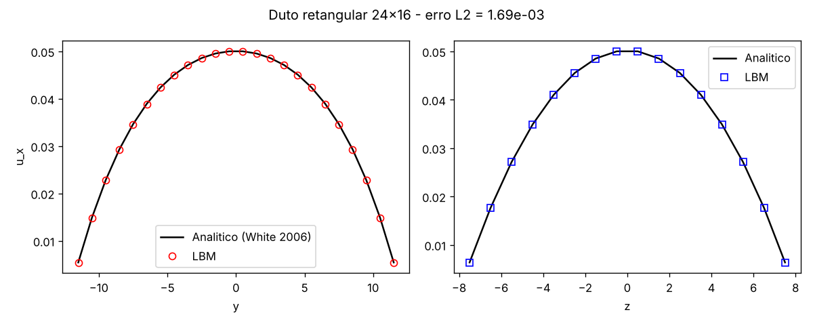
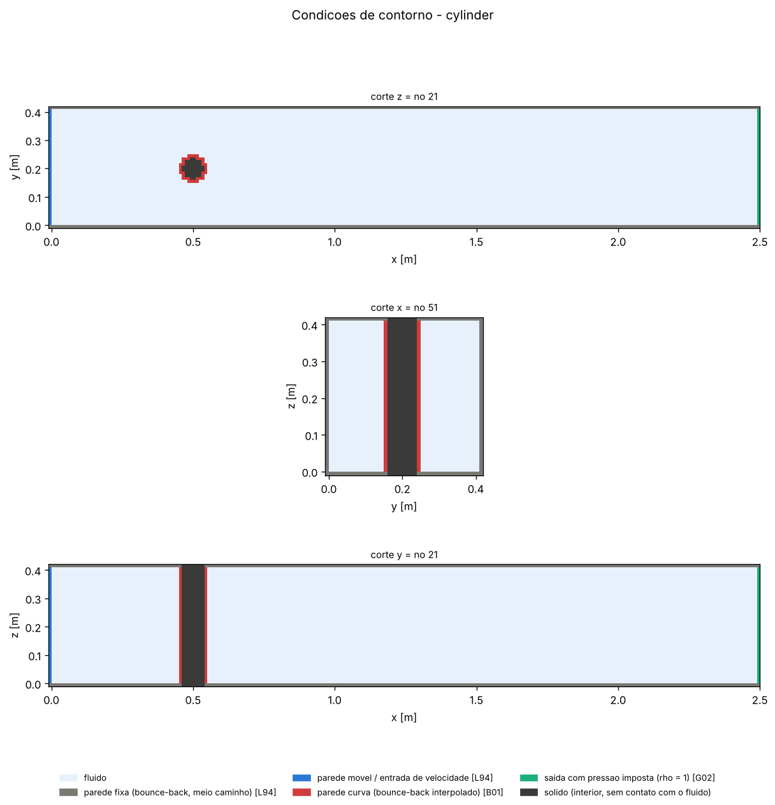
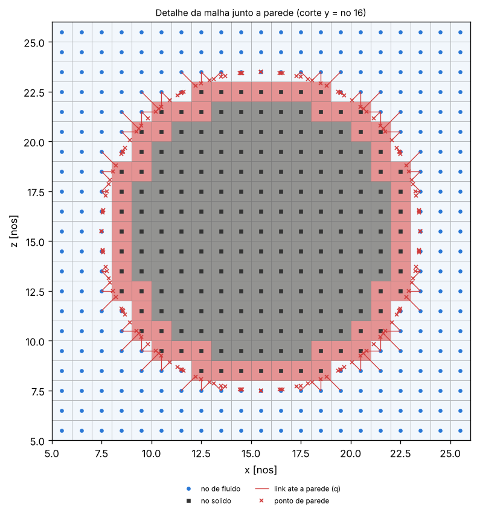
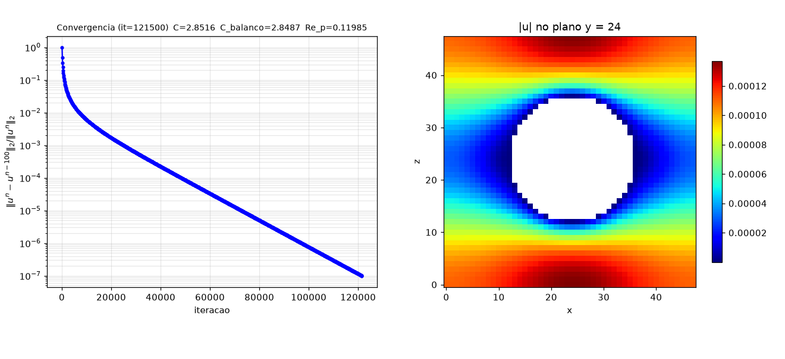

# lbm3d — LBM 3D para escoamentos laminares (D3Q27, cumulante K17)

Solver de lattice-Boltzmann tridimensional em Python/NumPy, com operador de colisão de
cumulantes parametrizado (K17, difusão de 4ª ordem), paredes curvas, painel HTML de
convergência, checkpoint/reinício e casos de validação da literatura. Roda no seu computador
ou **na nuvem, pelo GitHub Actions** (seção abaixo).

## Estrutura do repositório

```
lbm3d.py                    solver (método, casos de teste, checkpoint, VTK, linha de comando)
figuras.py                  imagens do domínio, condições de contorno, malha, escoamento e gráficos
acompanhar.py               acompanhamento da convergência (painel HTML, janela, terminal)
                            e controle de uma simulação em andamento (salvar / pausar / parar)
painel_template.html        modelo do painel HTML (autocontido, sem internet)
scripts/resumo_execucao.py  resumo de uma execução na nuvem (página do GitHub Actions)
tests/test_lbm3d.py         testes rápidos (pytest, ~15 s)
resultados/                 casos simulados, um por pasta (índice em resultados/README.md)
CLAUDE.md                   instruções para o Claude (documentar simulações, estimar tempo, git)
requirements.txt            numpy, matplotlib
requirements-dev.txt        + pytest
```

## Organização dos casos

Cada simulação grava tudo numa pasta própria, **`casos/<caso>_<parâmetros>/`** (ex.:
`casos/cylinder_D10_Re20`, `casos/spheres_L32_chi0.5`, `casos/duct_24x16`; `--outdir` escolhe outra):

```
casos/cylinder_D10_Re20/
  LEIAME.txt            o que há em cada subpasta e como continuar/controlar a simulação
  parametros.json       parâmetros da execução (malha, nu, omega, taxas de colisão, argumentos)
  execucao.log          cópia da saída do terminal (tabela de resíduos)
  estado.json           iteração, resíduos e situação (convergiu / interrompida / divergiu)
  validacao.txt         comparação com a referência da literatura
  dominio/              dominio_3d.png (vista 3D), dominio_cortes.png (fluido/sólido em 3 cortes)
  contorno/             contorno_cortes.png, contorno_3d.png (mapa colorido por tipo de condição),
                        condicoes_contorno.txt (descrição + contagem de nós/links),
                        perfil_entrada.png (cilindro: perfil de velocidade imposto)
  malha/                malha_corte.png (nós e linhas da malha), malha_detalhe.png (links
                        fluido→parede e a fração q do bounce-back interpolado), malha.txt
  escoamento/           final/ e parcial_itNNNNNNN/: velocidade_cortes.png (|u| em 3 cortes),
                        componentes_pressao.png (u_x, u_y, u_z, p), linhas_corrente.png, <caso>_itN.vtk
  graficos/             convergencia.png (resíduos), grandezas.png (C_D, C_L, C, erro L2 ...),
                        validação do caso, convergencia.csv e o painel convergencia.html
  checkpoint/           checkpoint.npz (estado completo para continuar)
```

As imagens do domínio, contorno e malha são geradas no início (≈2 s); para conferir a montagem de um
caso sem rodá-lo: `python lbm3d.py --case cylinder --res 10 --preprocess-only`. `--no-figs` desliga
todas as imagens (o VTK continua sendo gravado). A pasta `casos/`, os `.vtk` e os checkpoints não vão
para o repositório (`.gitignore`).

## Rodar no seu computador

Requisitos: Python ≥ 3.10, `numpy`, `matplotlib`.

```bash
pip install -r requirements.txt
python lbm3d.py --case duct                 # validação rápida (solução analítica)
python lbm3d.py --case cylinder --res 10    # benchmark Schäfer–Turek 3D-1Z
python lbm3d.py --restart casos/cylinder_D10_Re20   # continua de onde parou
```

Testes:

```bash
pip install -r requirements-dev.txt
pytest
```

## Rodar na nuvem (GitHub Actions)

1. Envie o repositório para o GitHub.
2. Na aba **Actions**, escolha **Simulacao LBM → Run workflow** e preencha o formulário:

   | Campo | Significado |
   |---|---|
   | `caso`, `modelo`, `res`, `chi` | como na linha de comando (`--case`, `--model`, `--res`, `--chi`) |
   | `extras` | outros argumentos, ex.: `--nu 0.01 --Re 20` |
   | `tol`, `max_iter` | critério de parada e limite total de iterações |
   | `tempo_max` | minutos de simulação por execução (padrão 320; o GitHub encerra jobs com 6 h) |
   | `reiniciar_de` | ID de uma execução anterior, para continuar do checkpoint dela |
   | `continuar` | se o tempo acabar antes de convergir, dispara sozinho a continuação |

   Também pela linha de comando, com o [GitHub CLI](https://cli.github.com):
   ```bash
   gh workflow run simulacao.yml -f caso=cylinder -f res=10 -f tol=1e-6
   ```
3. A página da execução mostra um resumo (iteração, situação, resultado da validação). Os arquivos
   ficam no artefato **`resultado`** por 30 dias: `convergencia.html` (abra no navegador),
   `convergencia.csv`/`.png`, `validacao.txt`, o último `.vtk` (ParaView), `checkpoint.npz` e o log.

**Simulações longas.** Ao atingir `tempo_max`, o solver para de forma limpa (`--max-time`), salva o
checkpoint e o artefato. Com `continuar` marcado, o fluxo dispara uma nova execução com
`reiniciar_de` apontando para a anterior; a cadeia segue até convergir ou atingir `max_iter`. O
reinício é bit a bit idêntico a uma execução contínua, e o `convergencia.csv` acumula todas as
partes. Para interromper uma cadeia, cancele a execução em andamento na aba Actions (o
solver trata o sinal de cancelamento e normalmente ainda salva o checkpoint) ou desligue o fluxo.

Os executores gratuitos (`ubuntu-latest`, 4 vCPUs) são ilimitados em repositórios públicos; em
repositórios privados contam na cota mensal de minutos da conta. A velocidade é parecida com a de
um notebook (~0,7–1 MLUPS): o cilindro com D = 10 leva ~3 h e a esfera com L = 48 ~4 h, cada um numa
execução só; casos maiores usam a continuação automática.

## Casos simulados

Resultados versionados em [`resultados/`](resultados) (índice e lista de arquivos em
[`resultados/README.md`](resultados/README.md)), todos com o modelo K17 e parâmetros do benchmark
(nenhum é ilustrativo).

### Duto retangular 24 × 16 — `duct_24x16`
Duto periódico com seção 24 × 16 nós, ν = 0,02, forçado por gradiente de pressão (u_max = 0,05), até
res(u) < 10⁻⁷ (12 600 it., ≈ 40 s no contêiner). **Erro L2 relativo do perfil = 1,694·10⁻³** (erro máximo
1,17·10⁻³ de u_max) contra a solução em série de White (2006). Rodado com a versão atual do código:
todas as subpastas estão preenchidas. Os valores de comparação citados antes neste README (BGK: 1,4·10⁻²;
cumulante clássico: 7,8·10⁻³) não têm arquivos em `resultados/` e não foram reverificados.

```bash
python lbm3d.py --case duct
```

[Pasta](resultados/duct_24x16) · 

### Cilindro Schäfer–Turek 3D-1Z, D = 10 — `cylinder_D10_Re20`
Canal 2,5 × 0,41 × 0,41 m (malha 251 × 43 × 43, 464 099 nós, dx = 0,01 m), Re = 20, Um = 0,1 (rede).
**C_D = 6,230 e Δp = 0,1654 Pa dentro das faixas de referência; C_L = 0,0102, 1,7 % acima da faixa**
[0,008; 0,010]. Rodado antes da reorganização das pastas (por isso só há o log, a validação e o gráfico
da janela de acompanhamento); `dominio/`, `contorno/` e `malha/` foram regerados com a versão atual, mas
os campos do escoamento não foram guardados e a rodada não foi repetida com esta versão.

```bash
python lbm3d.py --case cylinder --res 10
```

[Pasta](resultados/cylinder_D10_Re20) · 

### Arranjo cúbico de esferas, L = 32 — `spheres_L32_chi0.3`, `0.5`, `0.7`
Célula periódica 32³ com uma esfera de diâmetro χL, ν = 0,02, regime de Stokes (Re_p ≤ 0,11).
**C = 1,713 / 2,858 / 6,062 para χ = 0,3 / 0,5 / 0,7 (erro +0,77 / +0,47 / +1,04 %)** em relação a
Sangani & Acrivos (1982), valores tabelados em Bogner et al. (2015). Rodados antes da reorganização:
há log, CSV e painel de convergência; os campos do escoamento não foram guardados.

```bash
python lbm3d.py --case spheres --res 32 --chi 0.5     # idem --chi 0.3 e 0.7
```

[χ = 0,3](resultados/spheres_L32_chi0.3) · [χ = 0,5](resultados/spheres_L32_chi0.5) · [χ = 0,7](resultados/spheres_L32_chi0.7) ·


### Arranjo cúbico de esferas, L = 48, χ = 0,5 — `spheres_L48_chi0.5`
Mesmo caso com malha 48³. **C = 2,852 (erro +0,23 %)**; com L = 32 o erro era +0,47 %. A "ordem observada
≈ 1,8" citada anteriormente vem de só duas resoluções e não foi recalculada aqui. Rodado antes da
reorganização (sem campos do escoamento).

```bash
python lbm3d.py --case spheres --res 48 --chi 0.5
```

[Pasta](resultados/spheres_L48_chi0.5) · 

## Resíduos

A cada `--report-every` iterações (padrão 100) o terminal imprime uma linha da tabela:

```
 iteracao     res(u)    res(ux)    res(uy)    res(uz)   res(rho)   MLUPS      tempo  grandezas monitoradas
     3000  4.289e-03  4.289e-03  6.284e-07  4.545e-07  5.488e-09    0.67   0h00m08s  L2_error=0.0365582
```

* `res(u) = ‖uⁿ − uⁿ⁻¹⁰⁰‖₂ / ‖uⁿ‖₂` sobre os nós de fluido — critério de parada (`res(u) < --tol`, padrão 1e-7);
* `res(ux)`, `res(uy)`, `res(uz)`: a mesma variação por componente, normalizada por `‖uⁿ‖₂`
  (logo `res(u)² = res(ux)² + res(uy)² + res(uz)²`);
* `res(rho) = ‖ρⁿ − ρⁿ⁻¹⁰⁰‖₂ / ‖ρⁿ‖₂`;
* MLUPS, tempo decorrido e as grandezas do caso.

A mesma linha vai para `graficos/convergencia.csv` (colunas `res`, `res_ux`, `res_uy`, `res_uz`,
`res_rho`) e para `execucao.log`; `graficos/convergencia.png` mostra as curvas.
(Linha acima: duto 24×16, de `resultados/duct_24x16/execucao.log`.)

## Salvar resultados parciais e interromper

| Ação | Janela gráfica | Terminal (`--no-gui`) | Qualquer modo (outro terminal, segundo plano, remoto) |
|---|---|---|---|
| Salvar resultado parcial agora | botão **Salvar** / tecla `S` | `Ctrl+C` → `s` | `python acompanhar.py <pasta> --salvar` (ou crie `<pasta>/SALVAR`); `kill -USR1 <pid>` |
| Pausar / continuar | botão **Pausar** / tecla `P` | `Ctrl+C` → `p` (de novo `Ctrl+C` → `c`) | `--pausar` / `--continuar` (arquivo `<pasta>/PAUSAR`) |
| Salvar e parar | botão **Salvar e sair** / `Q` / fechar janela | `Ctrl+C` → `q` (ou `Ctrl+C` duas vezes) | `--parar` (arquivo `<pasta>/PARAR`); `SIGTERM` |
| Salvar parciais periodicamente | caixa **Auto-salvar parciais** | `--save-every N` (padrão 1000; 0 desliga) | idem |
| Continuar depois | `python lbm3d.py --restart <pasta do caso>` | idem | idem |

* **Resultado parcial** = `escoamento/parcial_itNNNNNNN/` (imagens + `.vtk`), gráficos atualizados em
  `graficos/` e `checkpoint/checkpoint.npz`.
* O checkpoint também é regravado a cada `--checkpoint-every` iterações (padrão 100), para limitar o
  que se perde se o processo for morto sem aviso.
* Os arquivos de controle são verificados a cada 10 iterações; `SALVAR` e `PARAR` são apagados ao serem
  atendidos, e sobras de uma execução anterior são apagadas no início.
* Sem terminal interativo (ex.: na nuvem, com saída redirecionada), `Ctrl+C`/`SIGTERM` salvam e encerram
  direto, sem menu.
* Ao parar, a última situação vai para `escoamento/parcial_itN/` (ou `final/`, se terminou) e `estado.json`.

O reinício reproduz bit a bit uma execução contínua. No reinício você pode alterar `--max-iter`,
`--tol`, `--save-every`, `--checkpoint-every`, `--no-gui`, `--no-figs`, `--outdir`, `--max-time`,
`--report-every`; os parâmetros físicos vêm do checkpoint. `--max-time M` encerra após M minutos
salvando o checkpoint (usado na nuvem).

### Painel HTML de convergência
A cada 100 iterações o código acrescenta uma linha a `graficos/convergencia.csv` e regrava
**`graficos/convergencia.html`**, uma página autocontida (sem internet, sem bibliotecas externas).
Basta abri-la no navegador: ela se recarrega sozinha a cada 5 s. Para atualização ao vivo sem
recarregar (e para acompanhar de outro computador via túnel SSH), sirva a pasta:

```bash
python acompanhar.py casos/spheres_L32_chi0.5 --servir        # http://127.0.0.1:8765/convergencia.html
python acompanhar.py casos/spheres_L32_chi0.5                 # (re)gera o HTML e abre no navegador
```

O painel mostra:
* estado da simulação (rodando / convergida / parada ou pausada / divergiu) e há quanto tempo veio a última leitura;
* iteração, resíduo, taxa de convergência (décadas por 1000 it.), velocidade (it/s e MLUPS) e
  **estimativa do tempo restante** até a tolerância (extrapolação log-linear das últimas 20 leituras);
* curva do resíduo em escala log com a tolerância e a extrapolação;
* evolução de cada grandeza do caso (C_D, C_L, Δp, C, erro L2 …) com a **faixa de referência da
  literatura** sombreada, a variação relativa nas últimas 500 it., e opção "Tudo"/"Último terço";
* valores ao passar o mouse e uma tabela com as últimas 30 leituras (incluindo os resíduos por
  componente); tema claro/escuro automático.

Outros modos: `--janela` (matplotlib), `--texto` (terminal, ex.: via ssh), `--png` (imagem estática).

## Método e equações

### 1. Equação de lattice-Boltzmann, rede D3Q27
`f_i(x + c_i, t+1) = f_i*(x, t)`, com `c_i ∈ {−1,0,1}³`, pesos `w = w_a w_b w_c`, sendo `(1/6, 2/3, 1/6)`,
e `c_s² = 1/3`, `ν = c_s²(1/ω₁ − 1/2)`, `p = c_s² ρ`.
Macroscópicas: `ρ = Σ f_i`, `ρu = Σ f_i c_i + F/2`.

### 2. Colisão de cumulantes [G15]
Transformação "chimera" para momentos centrais, direção por direção (z, y, x):

```
κ₀ = f₋ + f₀ + f₊
κ₁ = (f₊ − f₋) − u κ₀
κ₂ = (f₊ + f₋) − 2u (f₊ − f₋) + u² κ₀
```

Cumulantes (k = momentos centrais/ρ): `c₂ = k₂`, `c₃ = k₃`,
`c₂₁₁ = k₂₁₁ − (k₂₀₀k₀₁₁ + 2k₁₁₀k₁₀₁)`, `c₂₂₀ = k₂₂₀ − (k₂₀₀k₀₂₀ + 2k₁₁₀²)`,
`c₂₂₁ = k₂₂₁ − (k₂₀₀k₀₂₁ + k₀₂₀k₂₀₁ + 4k₁₁₀k₁₁₁ + 2k₁₀₁k₁₂₀ + 2k₀₁₁k₂₁₀)`,
`c₂₂₂ = k₂₂₂ − Σk₄k₂ − Σk₃k₃ + 2Σk₂k₂k₂` (as somas de partições estão escritas no código).

Relaxação de 2ª ordem com correção galileana [G15, Eqs. 58–63]:

```
∂x ux = −ω₁/2 (2c₂₀₀ − c₀₂₀ − c₀₀₂) − ω₂/2 (c₂₀₀ + c₀₂₀ + c₀₀₂ − 1)
(c₂₀₀ − c₀₂₀)* = (1−ω₁)(c₂₀₀ − c₀₂₀) − 3(1 − ω₁/2)(ux² ∂x ux − uy² ∂y uy)
(c₂₀₀ + c₀₂₀ + c₀₀₂)* = traço + ω₂(1 − traço) − 3(1 − ω₂/2)(ux² ∂x ux + uy² ∂y uy + uz² ∂z uz)
c₁₁₀* = (1 − ω₁) c₁₁₀
```

Força de corpo: o momento central de 1ª ordem troca de sinal (`−F/2ρ → +F/2ρ`).

### 3. Parametrização K17 (difusão de 4ª ordem) [G17], com ω₂ = 1

```
ω₃ = 8(ω₁−2)(1+2ω₁) / (7ω₁² − 14ω₁ − 8)          (c₁₂₀ + c₁₀₂, …)
ω₄ = 8(ω₁−2)(4ω₁−7) / (9ω₁² − 50ω₁ + 56)          (c₁₂₀ − c₁₀₂, …)
ω₅ = 24(ω₁−2)(3ω₁² − 7ω₁ − 2) / (29ω₁³ − 130ω₁² + 152ω₁ + 48)   (c₁₁₁)
A  = (4 + 2ω₁ − 3ω₁²) / (2 − 7ω₁ + 5ω₁²)
B  = (4 + 28ω₁ − 14ω₁²) / (6 − 21ω₁ + 15ω₁²)
c₀₂₂* = −(1/ω₁ − 1/2)·(2/3)·A·(∂y uy + ∂z uz)      (idem c₂₀₂, c₂₂₀)
c₁₁₂* = −(1/ω₁ − 1/2)·(1/3)·B·(∂x uy + ∂y ux)      (idem c₁₂₁, c₂₁₁)
c₅ = c₆ = 0
```

Essas expressões foram conferidas com o código-fonte aberto do VirtualFluids (TU Braunschweig),
de onde vêm o K17 e o artigo [G17].

**Faixa de uso:** com ω₂ = 1, A tem um polo em ω₁ = 1 e ω₄ tem um polo em ω₁ ≈ 1,556. Nos testes, o
K17 só foi estável e mais preciso para **ω₁ ≥ 1,75 (ν ≤ 0,024)**, o regime de baixa viscosidade para o
qual foi criado. Abaixo disso o código usa automaticamente o cumulante clássico [G15] e avisa.

### 4. Condições de contorno
* Parede (meio caminho) e parede móvel [L94]: `f_d̄(x_f, t+1) = f_d*(x_f) − 6 w_d ρ_w (c_d·u_w)`
* Parede curva, interpolação linear [B01], com `q` a fração do link até a parede:
  `q<½: f_d̄ = 2q f_d*(x_f) + (1−2q) f_d*(x_f − c_d)`; `q≥½: f_d̄ = f_d*/(2q) + (2q−1)/(2q) f_d̄*(x_f)`
* Saída com `ρ = 1` por extrapolação de não-equilíbrio [G02]:
  `f(x_b) = f^eq(1, u(x_{b−1})) + f(x_{b−1}) − f^eq(ρ(x_{b−1}), u(x_{b−1}))`
* Força no corpo por troca de quantidade de movimento [M02]: `F = Σ c_d [f_d*(x_f) + f_d̄(x_f, t+1)]`

## Casos (`--case`)

Os casos são classes em `lbm3d.py` (dicionário `CASES`). O modelo padrão é `--model k17`, mas o K17 só
vale para ω ≥ 1,75 (ν ≤ 0,024): fora disso o código usa automaticamente o cumulante clássico [G15] e
avisa. A coluna "modelo efetivo" indica o que roda com os parâmetros padrão.

| Caso | Descrição | Referência / grandeza | Parâmetros padrão | Modelo efetivo |
|---|---|---|---|---|
| `shearwave` | onda de cisalhamento periódica (decaimento viscoso) | decaimento exato `exp(−ν k² t)` [G17]; erro na viscosidade | N = 32, ν = 0,01 | K17 |
| `duct` | duto retangular periódico em x, forçado por gradiente de pressão | White (2006), Eq. 3-48; erro L2 do perfil | 24 × 16, ν = 0,02 | K17 |
| `cylinder` | cilindro em canal de seção quadrada, Re = 20 | Schäfer & Turek (1996), 3D-1Z; C_D ∈ [6,05; 6,25], C_L ∈ [0,008; 0,010], Δp ∈ [0,165; 0,175] Pa | D = 10, Um = 0,1 | K17 (para D ≥ 12 recai no cumulante clássico) |
| `spheres` | arranjo cúbico simples de esferas, regime de Stokes | Sangani & Acrivos (1982); arraste C = f_t/(3πμ d u_s) | L = 32, χ = 0,5, ν = 0,02 | K17 |
| `cavity` | cavidade cúbica com tampa móvel (demonstração) | comparar com Albensoeder & Kuhlmann (2005); perfis centrais | N = 32, Re = 100, U = 0,1 | cumulante clássico (ν = 0,032) |

Solução do duto (−a ≤ y ≤ a, −b ≤ z ≤ b, G = −dp/dx):

```
u(y,z) = 16a²G/(μπ³) Σ_{i=1,3,5,…} (−1)^((i−1)/2) [1 − cosh(iπz/2a)/cosh(iπb/2a)] cos(iπy/2a) / i³
```

Schäfer–Turek 3D-1Z: canal 2,5 × 0,41 × 0,41 m, cilindro com D = 0,1 m em (0,5; 0,2), ν = 10⁻³ m²/s,
entrada `U = 16·Um·y·z·(H−y)(H−z)/H⁴`, com Um = 0,45 m/s, Ū = 4Um/9 = 0,2 m/s,
`C_D = 2F_x/(ρŪ²DH)`, `C_L = 2F_y/(ρŪ²DH)`, `Δp = p(0,45; 0,2; 0,205) − p(0,55; 0,2; 0,205)`.

Arranjo de esferas: célula periódica L³ com uma esfera de diâmetro d = χL (fração sólida
φ = πχ³/6), forçada por aceleração g; u_s = velocidade superficial, f_t = força de arraste por
troca de quantidade de movimento + empuxo ρgV_p. Série de Sangani & Acrivos:
`1/C = 1 − 1,7601x + x³ − 1,5593x⁶ + 3,9799x⁸ − 3,0734x¹⁰ + …`, com x = φ^(1/3) (boa até χ ≈ 0,7);
valores de referência para χ = 0,2…0,9 retirados da Tab. 1 de Bogner et al. (2015).

## Referências
* [G15] M. Geier, M. Schönherr, A. Pasquali, M. Krafczyk, *The cumulant lattice Boltzmann equation in three dimensions: Theory and validation*, Comput. Math. Appl. 70 (2015) 507–547.
* [G17] M. Geier, A. Pasquali, M. Schönherr, *Parametrization of the cumulant lattice Boltzmann method for fourth order accurate diffusion. Part I*, J. Comput. Phys. 348 (2017) 862–888.
* [L94] A.J.C. Ladd, J. Fluid Mech. 271 (1994) 285–309.
* [B01] M. Bouzidi, M. Firdaouss, P. Lallemand, Phys. Fluids 13 (2001) 3452–3459.
* [G02] Z. Guo, C. Zheng, B. Shi, Chinese Physics 11 (2002) 366–374.
* [M02] R. Mei, D. Yu, W. Shyy, L.-S. Luo, Phys. Rev. E 65 (2002) 041203.
* M. Schäfer, S. Turek, *Benchmark computations of laminar flow around a cylinder*, Notes Numer. Fluid Mech. 52 (1996) 547–566.
* A.S. Sangani, A. Acrivos, *Slow flow through a periodic array of spheres*, Int. J. Multiphase Flow 8 (1982) 343–360.
* S. Bogner, S. Mohanty, U. Rüde, *Drag correlation for dilute and moderately dense fluid-particle systems using the lattice Boltzmann method*, Int. J. Multiphase Flow 68 (2015) 71–79 ([arXiv:1401.2025](https://arxiv.org/abs/1401.2025)).
* F.M. White, *Viscous Fluid Flow*, 3ª ed., McGraw-Hill, 2006.
